# Light CRM — Manual for Admins

**For:** people with the **Admin** role, who run Light CRM for the Commercial team.\
**Covers:** Light CRM Release 1 (November 2026). The screens are in English; you can switch to Bulgarian at any time under **My profile**.\
**Time to read:** about 30 minutes. Chapters 1–2 cover what you share with every user. Chapters 3–11 cover administration.

> **What an Admin can do.** Everything a Sales Manager can do (see and change every record, reassign, reopen, restore, import), and in addition:
> - **user management**;
> - **settings**;
> - **lists** and **pipeline stages**;
> - the **audit log**;
> - **rolling back imports**;
> - **GDPR tools** for personal data;
> - **integrations** with ERP, Billing and Conclusion.
>
> Installing, backing up and upgrading the server is described in the [operations guide](../operations-guide.md), not here.

---

## Contents

1. [Getting started](#1-getting-started)
2. [Sales work and team oversight (summary)](#2-sales-work-and-team-oversight-summary)
3. [Managing users](#3-managing-users)
4. [Settings](#4-settings)
5. [Lists (reference data)](#5-lists-reference-data)
6. [Pipeline stages](#6-pipeline-stages)
7. [The audit log](#7-the-audit-log)
8. [Imports and rolling back](#8-imports-and-rolling-back)
9. [Personal data (GDPR)](#9-personal-data-gdpr)
10. [Integrations with other applications](#10-integrations-with-other-applications)
11. [The AI assistant: what to tell users](#11-the-ai-assistant-what-to-tell-users)
12. [Troubleshooting and support](#12-troubleshooting-and-support)
13. [Glossary](#13-glossary)
14. [Quick reference](#14-quick-reference)

**How to read the steps.** Names of buttons, menus and fields are in **bold**, exactly as they appear on screen. *Italic* marks something you type. The people and companies in the screenshots are fictional.

---

## 1. Getting started

### 1.1 Your first sign-in

The first Admin is created by IT on the server (`create-admin`, see the operations guide). Other Admins are created by an Admin, like any other user ([chapter 3](#3-managing-users)). You receive a **one-time link**: open it, choose a password of **at least 12 characters** that is not a common password, and select **Save password**. Then sign in with your email and password.

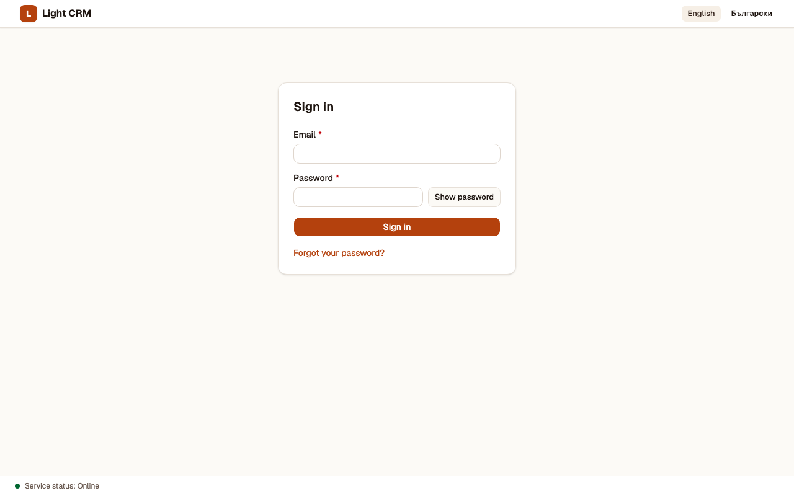
*Figure 1. The sign-in page.*

### 1.2 Secure your account

Set up two-factor sign-in **before anything else**: **your name → My profile → Set up two-factor sign-in**.
1. Scan the QR code with an authenticator app.
2. Enter the code the app shows.
3. Store the ten recovery codes safely.

You can require two-factor sign-in for all Admins ([chapter 4](#4-settings)).

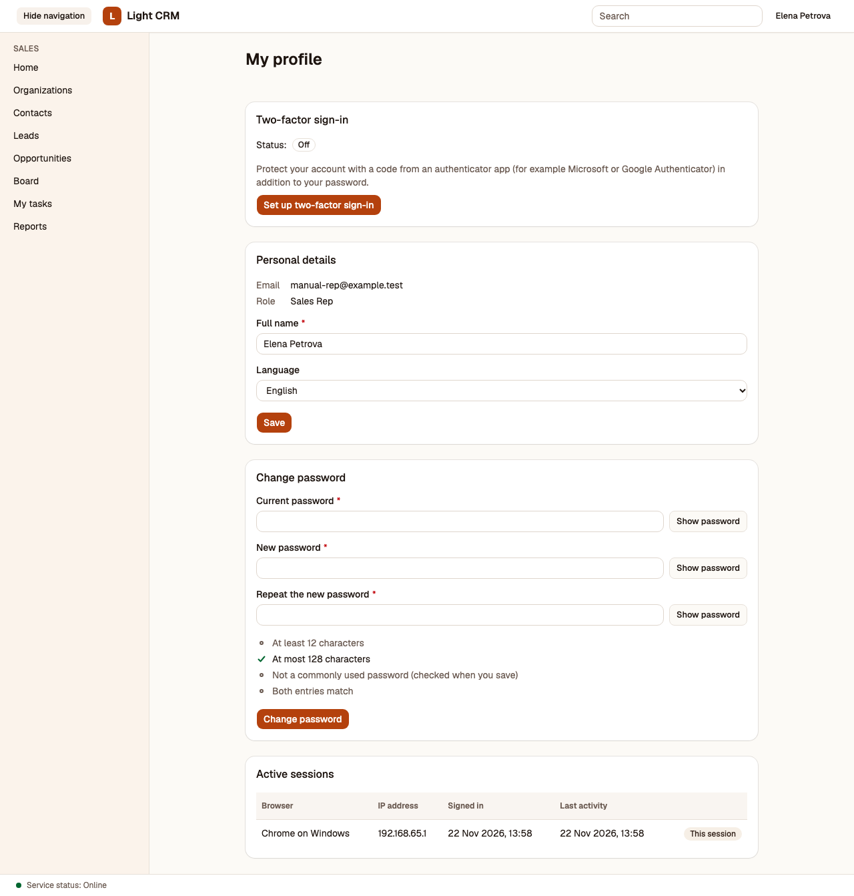
*Figure 2. My profile.*

### 1.3 The screen

Your menu has the sales areas and the **Administration** group:

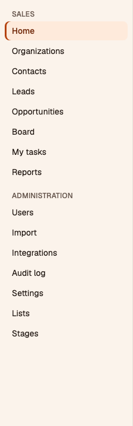
*Figure 3. Your menu.*

| Menu item | Chapter |
|---|---|
| **Users** | [3](#3-managing-users) |
| **Import** | [8](#8-imports-and-rolling-back) |
| **Integrations** | [10](#10-integrations-with-other-applications) |
| **Audit log** | [7](#7-the-audit-log) |
| **Settings** | [4](#4-settings) |
| **Lists** | [5](#5-lists-reference-data) |
| **Stages** | [6](#6-pipeline-stages) |

The top bar has **Search**, the **Assistant** button and **your name**, which opens **My profile** and **Sign out**. In every list, **click a row** to open the record; **Ctrl-click** (Cmd-click on a Mac) opens it in a new tab.

---

## 2. Sales work and team oversight (summary)

You have every sales and management capability. The **Sales Rep manual** and the **Sales Manager manual** describe them step by step:

- **Home**: the dashboard (**Everyone / Mine**, by year). Every figure card opens the list behind it.
- Organizations, contacts, leads (qualification and conversion), opportunities (sales path, close as won or lost), the pipeline board, activities and tasks.
- **Change any record**, reassign with **New owner → Assign**, **Reopen** closed opportunities and disqualified leads, and **Restore** archived records.
- **Reports**, and **Export XLSX / CSV** on every list.

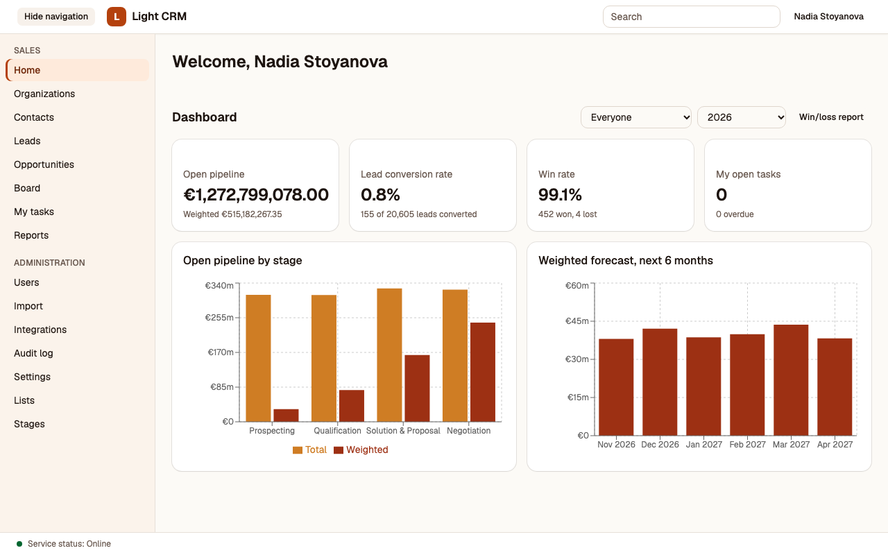
*Figure 4. The dashboard.*

---

## 3. Managing users

**User stories:**
- *As an Admin, I want to give a new colleague access with the right role, without ever handling their password.*
- *As an Admin, I want to remove access immediately when someone leaves, while keeping their records.*

### 3.1 The four roles

| Role | Typical person | Can |
|---|---|---|
| **Admin** | CRM administrator | Everything, including this chapter |
| **Sales Manager** | Team lead | See and change all records, reassign, reopen, restore, import, export |
| **Sales Rep** | Account manager | See all records, create records, change and close their own, export |
| **Viewer** | Stakeholder | See all records, dashboards and reports; no changes |

Give people the lowest role that lets them do their job.

### 3.2 Find users

Select **Users**. Search by name or email, and filter by **role** and **status** (active or deactivated). Locked accounts are marked **Locked**.

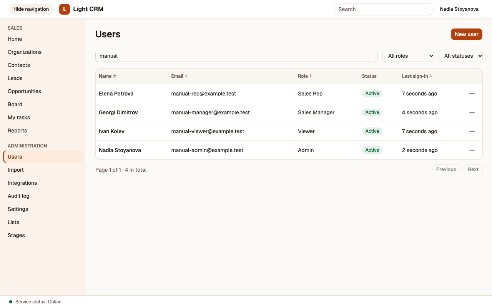
*Figure 5. Users.*

### 3.3 Create a user

1. Select **Users → New user**.
2. Enter the **Email** and **Full name**, choose the **Role** and the **Language**, and select **Create user**.
3. The **One-time password link** panel appears. **Copy the link now: it is not shown again once you close this panel.** It can be used once and expires on the date shown.
4. If email is configured, the link has also been emailed. Otherwise give it to the person yourself, through a channel only they can read.

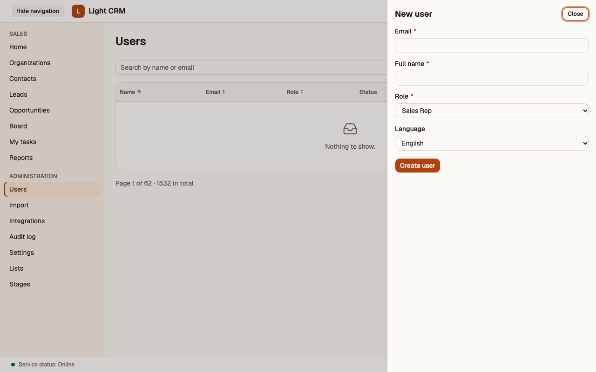
*Figure 6. Creating a user.*

You never see or set the user's password. They choose it with the link.

### 3.4 Change a user, and the account actions

Open a user (click the row) or use the row menu (**⋯**).

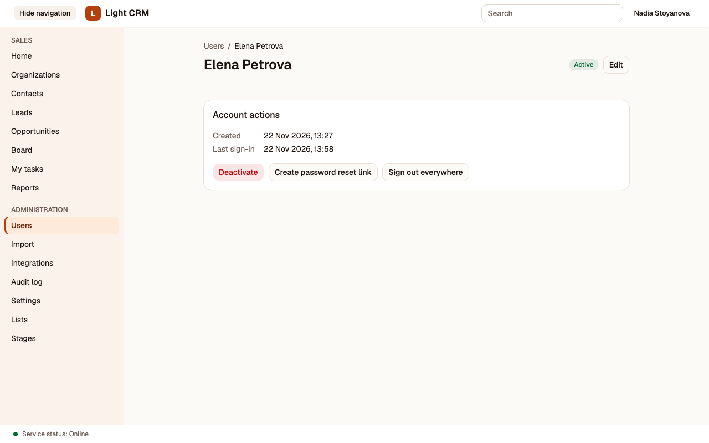
*Figure 7. A user's account actions.*

| Action | When to use it | What happens |
|---|---|---|
| **Edit** | Change the name, role or language | Role changes are recorded in the audit log. |
| **Create password reset link** | The person forgot their password and email is not configured | A new one-time link is shown once, as in 3.3. |
| **Unlock** | The account is **Locked** after 5 wrong passwords | The person can try again at once, instead of waiting 15 minutes. |
| **Sign out everywhere** | A lost laptop or phone, or a suspected compromise | Every session of the person ends. |
| **Deactivate** | The person leaves, or must lose access | They are signed out at once and can't sign in. **Their records stay**, with them as owner. |
| **Activate** | The person returns | They can sign in again with their existing password. |

> **After deactivating someone,** ask their Sales Manager to **reassign** the person's open leads and opportunities. Nobody is assigned to work them otherwise.

**Last-Admin protection:** you can't deactivate the last active Admin or change their role. The button is disabled and explains why. Keep at least two Admins, so the CRM is never without one.

If an Admin loses their two-factor device and has no recovery codes, IT can turn two-factor off on the server (`reset-mfa`, see the operations guide).

---

## 4. Settings

**User story:** *As an Admin, I want to set how long sessions last and when a deal counts as neglected, to fit company policy.*

Select **Settings**, change the values, and select **Save**.

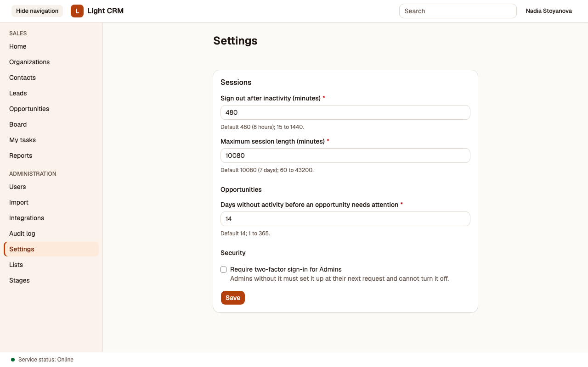
*Figure 8. Settings.*

| Setting | Default | Range | Effect |
|---|---|---|---|
| **Sign out after inactivity (minutes)** | 480 (8 hours) | 15–1440 | Users are signed out after this long without activity. They are warned 5 minutes before. |
| **Maximum session length (minutes)** | 10080 (7 days) | 60–43200 | Users must sign in again after this long, active or not. |
| **Days without activity before an opportunity needs attention** | 14 | 1–365 | When the **Needs attention** badge appears on deals. |
| **Require two-factor sign-in for Admins** | Off | — | Admins without two-factor must set it up at their next request, and can't turn it off. |

Every change is recorded in the audit log.

---

## 5. Lists (reference data)

**User story:** *As an Admin, I want to keep the choice lists in both languages, matching how the team works.*

Select **Lists**. There are tabs for **Industries**, **Lead sources**, **Disqualification reasons**, **Loss reasons** and **External systems**.

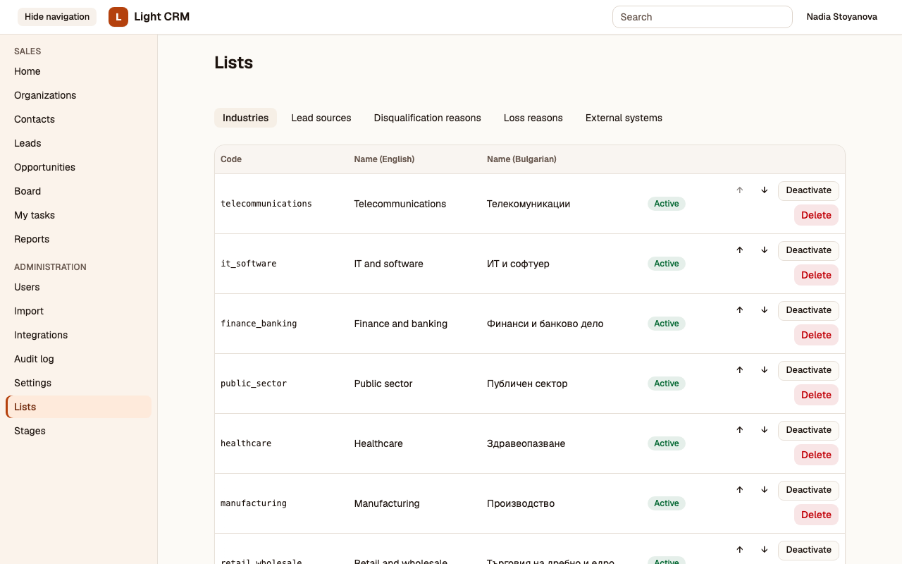
*Figure 9. Lists.*

- **Add value:** enter a **code** (lower-case letters, digits and _), the **English** and **Bulgarian** names, and select **Add value**.
- **Rename:** edit the names and select **Save names**. The code doesn't change, so reports and integrations keep working.
- **Order:** use the arrows to change the order users see.
- **Deactivate** removes a value from new choices but keeps it on existing records. **Delete** works only for values that were never used.

---

## 6. Pipeline stages

**User story:** *As an Admin, I want the pipeline stages and their probabilities to match our sales process, so that the forecast is meaningful.*

Select **Stages**.

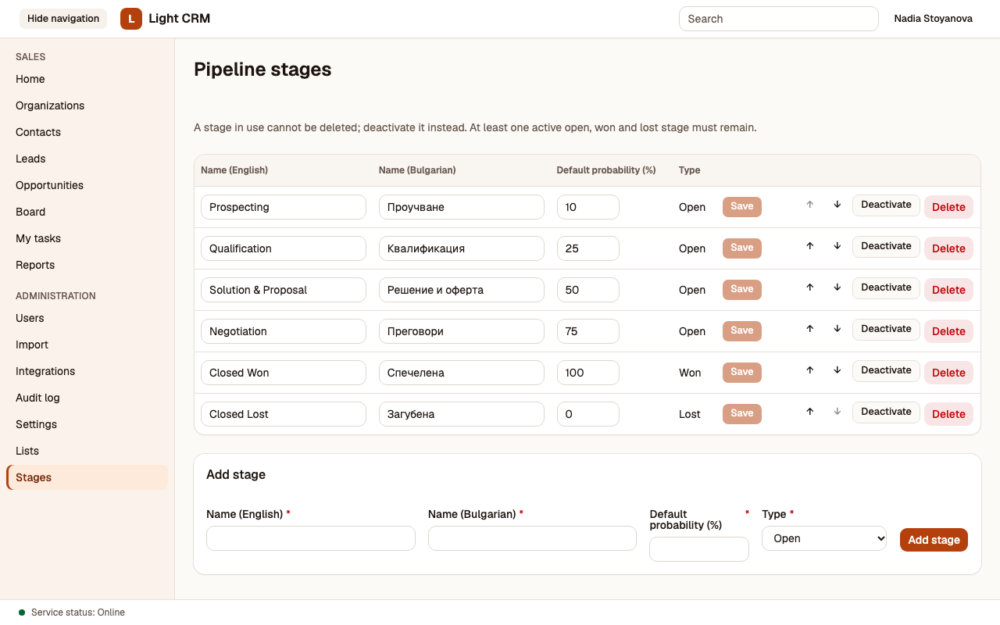
*Figure 10. Pipeline stages.*

- Each stage has an **English** and a **Bulgarian** name, a **Default probability (%)**, and a **Type**: **Open**, **Won** or **Lost**. Edit a row and select **Save**.
- The arrows change the order on the board, the sales path and the reports.
- **Add stage** adds a new stage.
- A stage that is **in use can't be deleted**; **Deactivate** it instead. At least one active open, won and lost stage must remain.
- A stage's **type** is fixed once the stage is created. Its names and probability can change later.
- A stage's default probability is what a deal gets when it enters the stage, unless the owner set a probability by hand.

Agree stage changes with the Sales Managers first. They change the board, the forecast and the reports for everyone.

---

## 7. The audit log

**User story:** *As an Admin, I want to find out who changed what and when, for example when a customer's data looks wrong.*

Select **Audit log**. It lists sign-ins and failed sign-ins, every create, change and delete (by users and by integrations), exports, imports and role changes. The log **can't be edited or deleted** in the application.

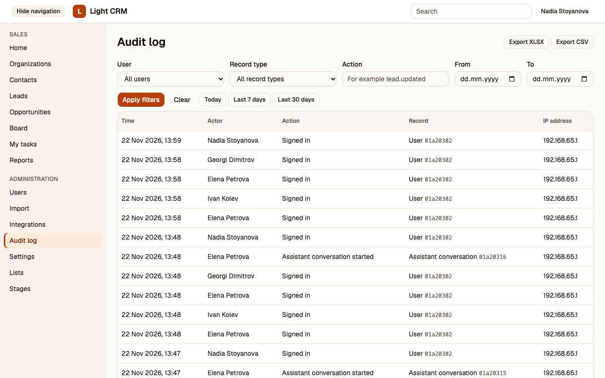
*Figure 11. The audit log.*

1. Filter by **User**, **Record type**, **Action** (for example *lead.updated*) and **From / To**, or use **Today**, **Last 7 days** or **Last 30 days**. Then select **Apply filters**.
2. Click an entry's time to open it. **Changes** shows each field **before** and **after**; changed fields are marked.
3. **Export XLSX / CSV** downloads the filtered log, for example for an internal audit.

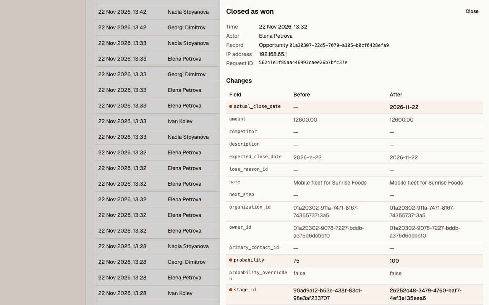
*Figure 12. One audit entry with its changes.*

The **Request ID** links an entry to the server logs. Give it to IT when you report a problem.

---

## 8. Imports and rolling back

Sales Managers and Admins can import organizations, contacts, leads and opportunities from XLSX or CSV. The **Sales Manager manual** (chapter 7) describes the steps:
1. **Upload** the file.
2. Map the **Columns**.
3. **Save and check**.
4. Review the **Preview**.
5. Choose **Import all** or **Import, skipping invalid rows**.

The file format is in the [import format](../import-format.md).

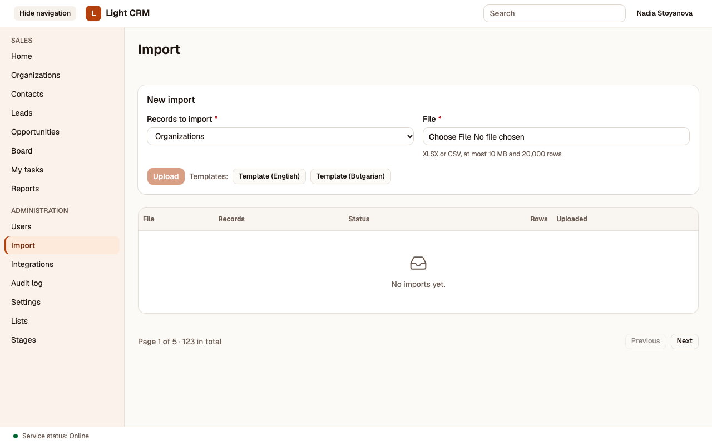
*Figure 13. Imports.*

**Rolling back an import (Admins only).**
1. Open the import from the list. Its status is **Imported**.
2. Under **Roll back**, select **Roll back import** and confirm.
3. The records the import **created** are archived, and the records it **updated** get their earlier values back. Records **changed by someone since the import are kept**; the report lists each one.

The import's status becomes **Rolled back**.

---

## 9. Personal data (GDPR)

**User stories:**
- *As an Admin, I want to give a person all the data we hold about them when they ask.*
- *As an Admin, I want to erase a person's details on request without losing the commercial history.*

Open the contact. The **Personal data (GDPR)** section is visible to Admins only.

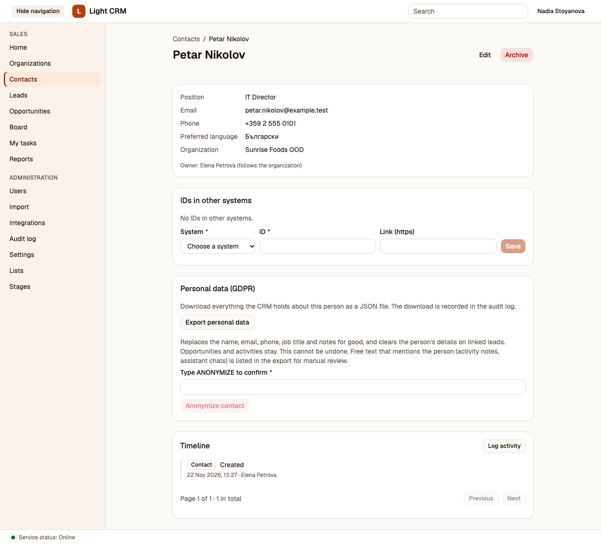
*Figure 14. Personal data tools on a contact.*

- **Export personal data** downloads everything the CRM holds about the person as a JSON file. The download is recorded in the audit log.
- **Anonymize contact** replaces the name, email, phone, job title and notes **for good**, and clears the person's details on linked leads. Opportunities and activities stay. Type *ANONYMIZE* to confirm. **This can't be undone.** Free text that mentions the person (activity notes, assistant chats) is listed in the export. Review it by hand.

---

## 10. Integrations with other applications

**User story:** *As an Admin, I want to connect ERP, Billing and Conclusion to the CRM safely, see their activity, and cut them off at once if needed.*

Each connected application is an **integration client**. A client is not a person: it can't sign in to the screens, and it reaches only the data its **scopes** allow. Integrations never reach user administration, settings, imports, exports, the audit log, GDPR tools or the assistant. The technical details for the other teams are in the [integration guide](../integration-guide.md).

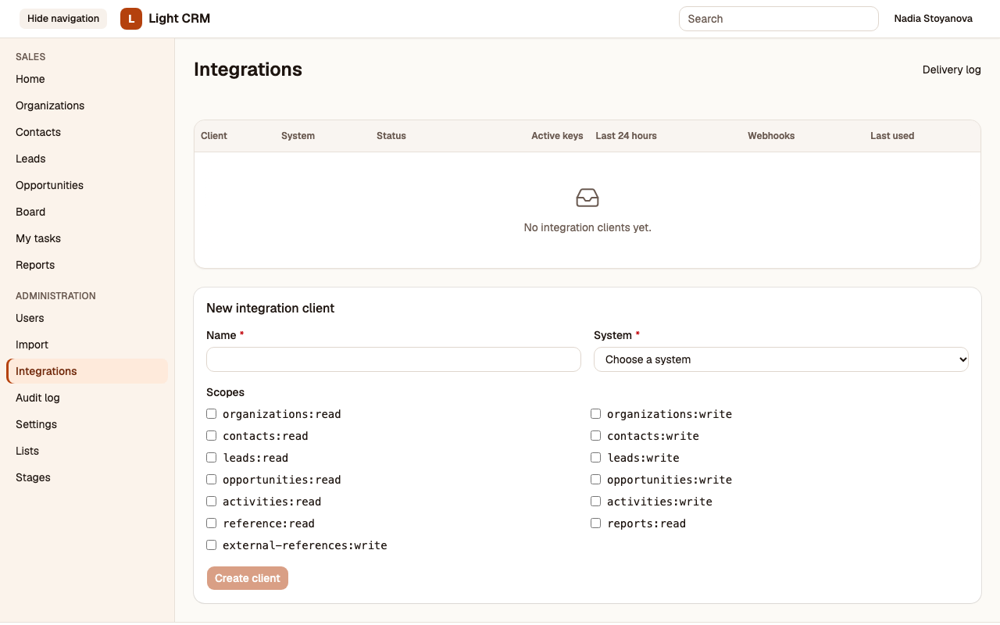
*Figure 15. Integrations.*

### 10.1 Connect an application

1. Select **Integrations**. Under **New integration client**, enter a **Name**, choose the **System** (ERP, Billing or Conclusion), and tick only the **Scopes** it needs, for example `organizations:read` and `external-references:write`. Select **Create client**.
2. Open the client and fill in its **Settings**: **Default owner** (owner of the records it creates), **Allowed addresses** (optional IP allowlist), **Technical contact** and **Requests per minute**. Then select **Save** and **Activate**.
3. Under **API keys**, select **Create key**, give it a label and an expiry, and **copy the key now**. It is shown only once. Give it to the system's technical contact through a secure channel.
4. Optionally, under **Webhooks**, select **New subscription** to send the application events. Enter the HTTPS **Endpoint URL** and the **Event types**, then select **Subscribe**. **Copy the signing secret now**; it is shown only once.

### 10.2 Keep integrations healthy

- The client list shows each client's **Status**, its active keys, its requests and errors in the last 24 hours, its webhooks and when it was last used.
- **Delivery log** lists every webhook delivery: **Waiting**, **Retrying**, **Delivered** or **Failed**. Open one to see the attempts; **Redeliver** sends it again.

  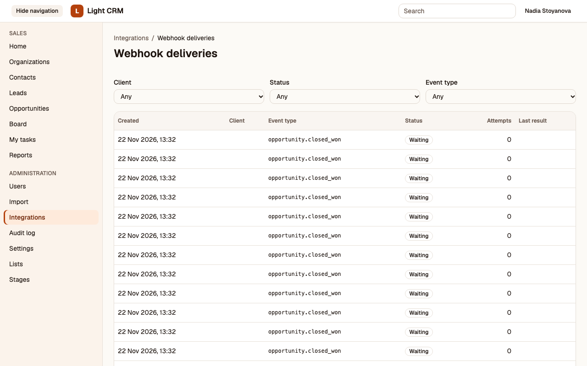
  *Figure 16. The webhook delivery log.*

- A red number next to **Integrations** in the menu, and a banner in the administration area, warn you about failing or suspended deliveries.
- **Rotate keys:** create a new key, let the other team switch to it, then **Revoke** the old one. A client can have two active keys at a time.
- **Emergency stop:** **Deactivate** the client. All its requests are refused at once and its webhooks pause.

Records and audit entries created by an integration show it as the actor, for example "ERP (integration)". Cross-system IDs, such as the ERP customer number, appear on records under **IDs in other systems**.

---

## 11. The AI assistant: what to tell users

The assistant is switched on or off on the server (`AI_ENABLED`, see the operations guide). When it is on, every user has an **Assistant** button in the top bar.

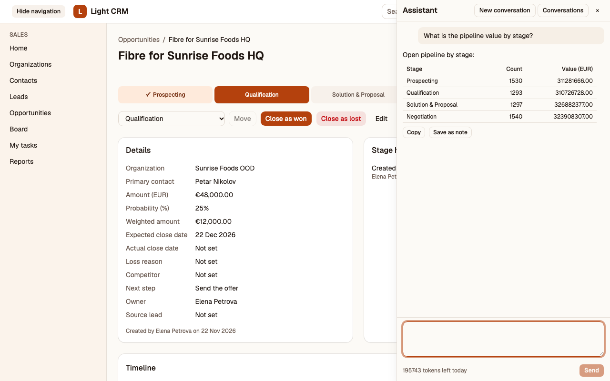
*Figure 17. The assistant. (Example from a test system.)*

Points to share with users:
- It **only reads** CRM data, with the user's own permissions. It never creates, changes or deletes anything.
- It answers in English or Bulgarian, links the records it mentions, and can draft emails and call summaries. **Save as note** saves a checked draft on a record.
- It can be wrong. Figures must be checked before use.
- Each user has a **daily limit**, shown under the question box. If the AI provider is unavailable, the chat shows an error and the rest of the CRM keeps working.

---

## 12. Troubleshooting and support

| A user reports… | Check / do |
|---|---|
| "I can't sign in" | **Users**: is the account **Locked** (→ **Unlock**) or **Deactivated** (→ **Activate**, if appropriate)? |
| "I forgot my password" | **Create password reset link**, and hand it over securely. |
| "My link doesn't work" | It is used or expired. Create a new reset link. |
| "I can't change this record" | Check the record's owner and the person's role. Reps change only their own records; Viewers change nothing. |
| "Someone changed my deal" | **Audit log**: filter by the record type and the date, and open the entry to see who changed what. |
| "The data looks wrong after an import" | Open the import and check its preview. If needed, **Roll back import**. |
| "The assistant is missing or failing" | AI may be switched off, the daily limit may be reached, or the provider may be down. Check with IT (operations guide). |
| An integration stopped working | The client's status, its keys (expired or revoked?), the **Delivery log** and the error counts. |
| Anything else | Ask for the time and what the person was doing. Find the entry in the audit log and pass the **Request ID** to IT. |

---

## 13. Glossary

| Term | Meaning |
|---|---|
| **Role** | Admin, Sales Manager, Sales Rep or Viewer: sets what a user may do. |
| **One-time link** | The link a user receives to set or reset their own password. It can be used once and it expires. |
| **Locked** | An account blocked for 15 minutes after 5 wrong passwords. |
| **Deactivated** | An account that can't sign in. Its records are kept. |
| **Audit log** | The permanent record of sign-ins, changes, exports and imports. |
| **Import batch** | The records loaded from one file; it can be rolled back. |
| **Anonymize** | Irreversibly replace a person's personal details, keeping the commercial history. |
| **Integration client** | A connected application (ERP, Billing, Conclusion) that uses the API with an API key. |
| **Scope** | A permission given to an integration client, for example `leads:read`. |
| **Webhook** | A message the CRM sends to another application when something changes. |

---

## 14. Quick reference

| I want to… | Go to |
|---|---|
| Give someone access | **Users → New user** → copy the one-time link |
| Reset a password | The user → **Create password reset link** |
| Unblock a locked account | The user → **Unlock** |
| Remove access | The user → **Deactivate**, then ask the manager to reassign their records |
| Change the session length or the "needs attention" days | **Settings** |
| Add a lead source or loss reason | **Lists** |
| Change the pipeline | **Stages** |
| See who changed something | **Audit log** → filter → open the entry |
| Undo an import | **Import** → the import → **Roll back import** |
| Answer a data-subject request | The contact → **Export personal data** / **Anonymize contact** |
| Connect ERP, Billing or Conclusion | **Integrations → New integration client** → **Create key** |
| Stop an integration at once | **Integrations** → the client → **Deactivate** |
