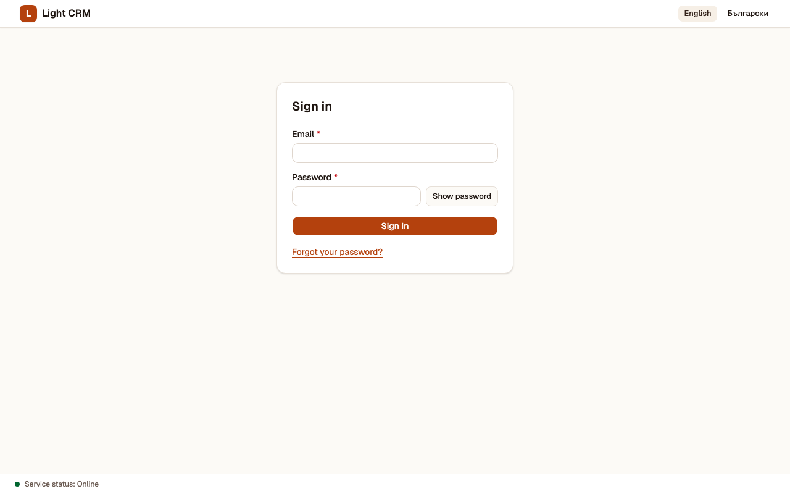
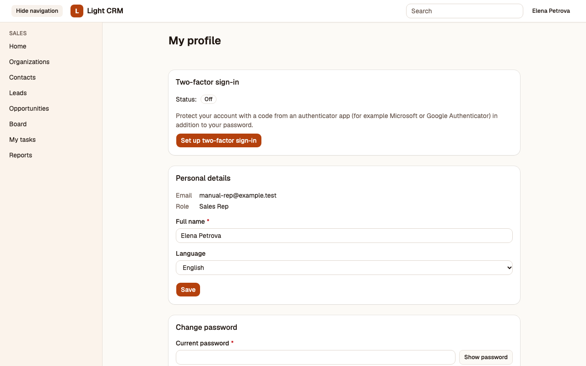
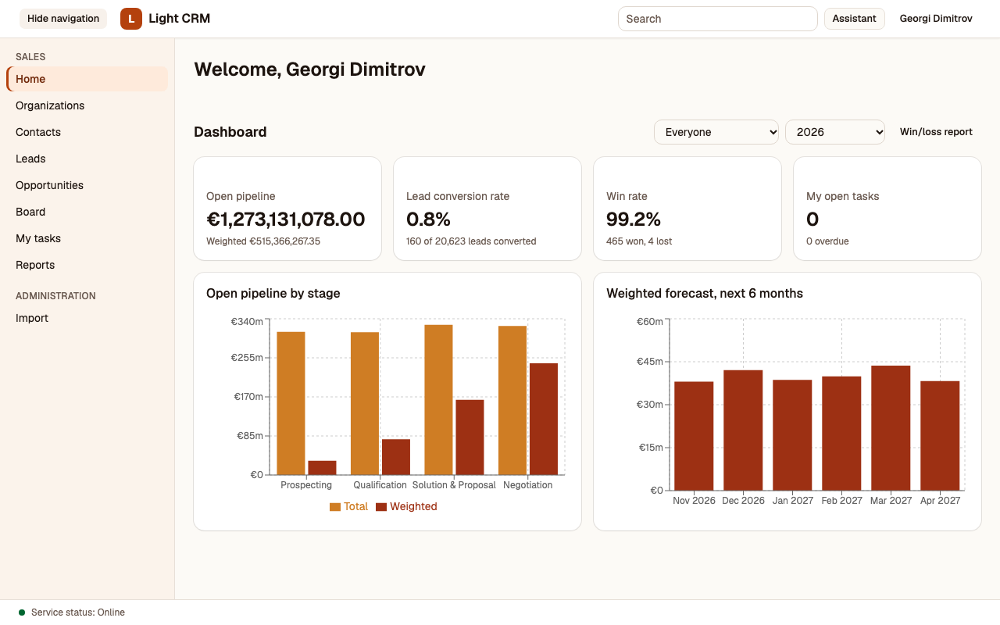
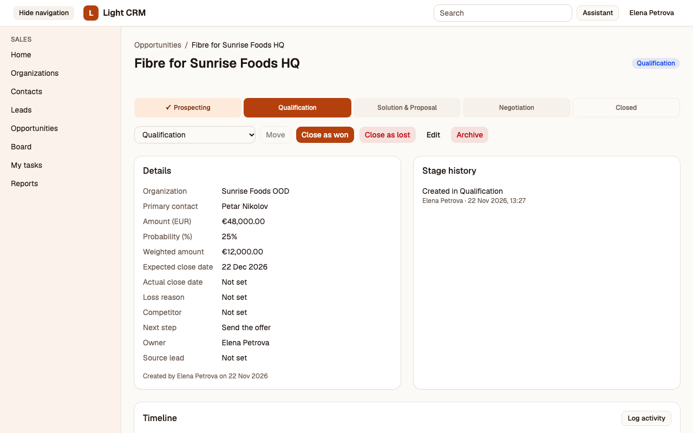
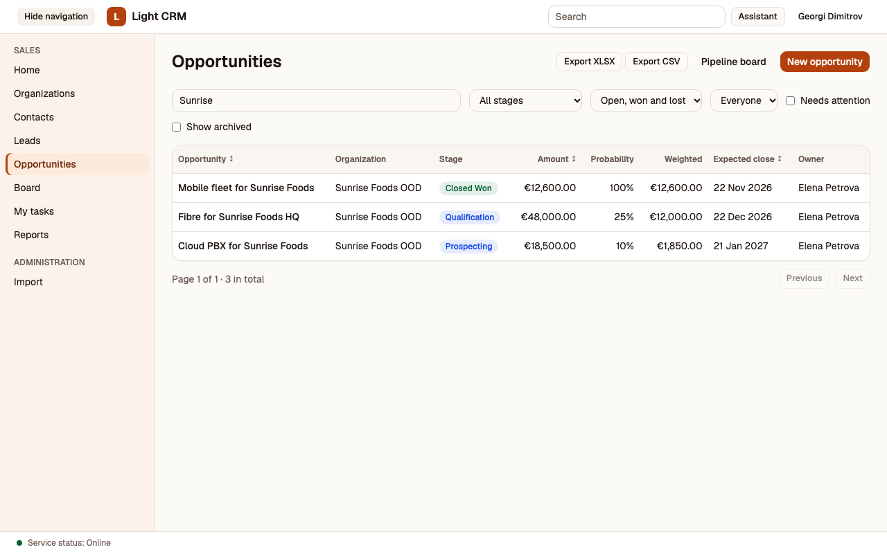
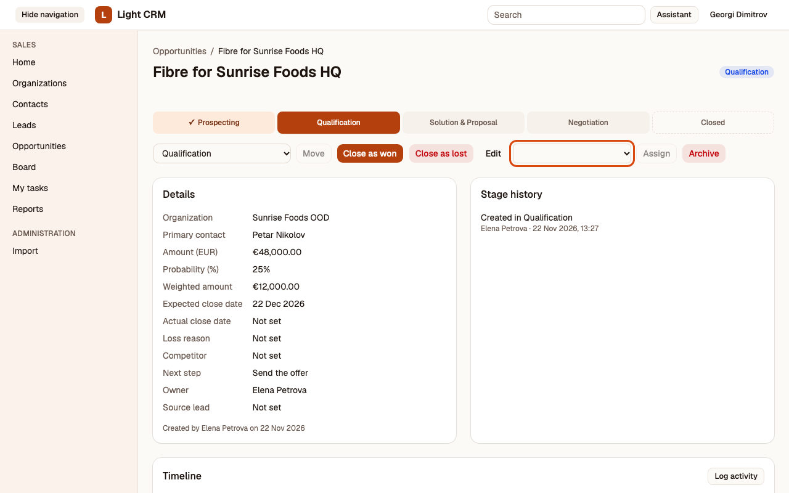
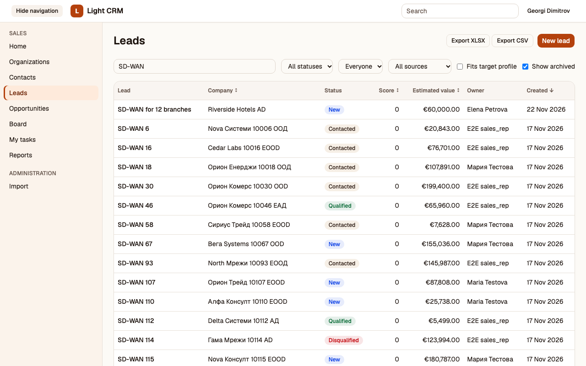
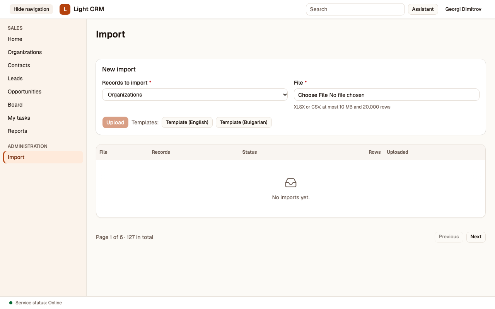
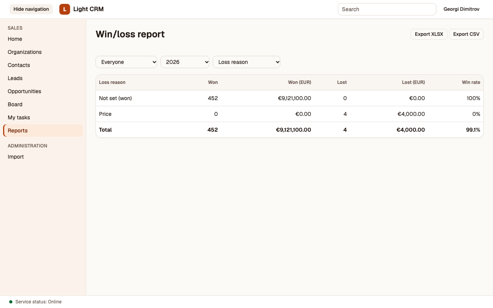
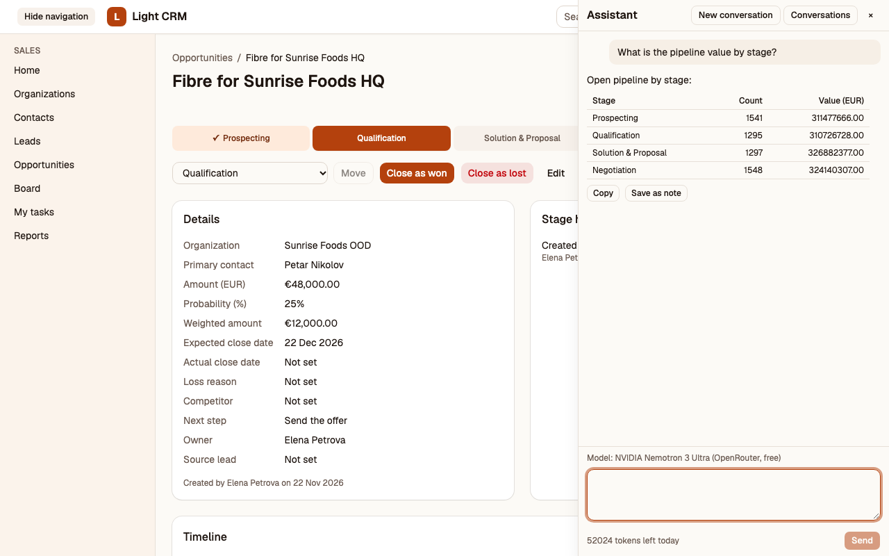

# Light CRM — Manual for Sales Managers

**For:** team leads with the **Sales Manager** role.\
**Covers:** Light CRM Release 1 (November 2026). The screens are in English; you can switch to Bulgarian at any time (see [1.4](#14-language-profile-and-security)).\
**Time to read:** about 25 minutes. Chapters 1–3 cover what you share with your team; chapters 4–8 are specific to managers.

> **What a Sales Manager can do.** Everything a Sales Rep does (see, create, change and close records), plus:
> - **change and close any record**, not only your own;
> - **reassign** owners;
> - **reopen** closed opportunities and disqualified leads;
> - **restore** archived records;
> - follow the **team's** dashboard and win/loss report;
> - **import** data from Excel.
>
> User administration, settings and the audit log belong to the Admin.

---

## Contents

1. [Getting started](#1-getting-started)
2. [The team dashboard](#2-the-team-dashboard)
3. [Everyday sales work (summary)](#3-everyday-sales-work-summary)
4. [Coaching the pipeline: any record, any owner](#4-coaching-the-pipeline-any-record-any-owner)
5. [Reassigning work](#5-reassigning-work)
6. [Reopening and restoring](#6-reopening-and-restoring)
7. [Importing data from Excel](#7-importing-data-from-excel)
8. [Reports and exports](#8-reports-and-exports)
9. [The AI assistant](#9-the-ai-assistant)
10. [What only an Admin can do](#10-what-only-an-admin-can-do)
11. [Troubleshooting](#11-troubleshooting)
12. [Glossary](#12-glossary)
13. [Quick reference](#13-quick-reference)

**How to read the steps.** Names of buttons, menus and fields are in **bold**, exactly as they appear on screen. *Italic* marks something you type. An orange frame in a screenshot points at the control the step is about. The people and companies in the screenshots are fictional.

---

## 1. Getting started

### 1.1 First sign-in

An Admin creates your account and gives you a **one-time link**. The link expires, so use it soon.

1. Open the link and type a new password twice. The rules: **at least 12 characters**, at most 128, and not a commonly used password. A strength bar rates the password from weak to strong.
2. Select **Save password**.
3. Sign in on the Light CRM address with your work **Email** and **Password**.

*Figure 1. The sign-in page.*

After **5 wrong passwords** the account is locked for **15 minutes**. **Forgot your password?** sends you a reset link if email is set up; otherwise an Admin can give you a link.

### 1.2 The screen

*Figure 2. The top bar: navigation toggle, home, **Search**, **Assistant** and your name.*

Your menu has the sales areas, plus **Administration → Import**:

*Figure 3. Your menu.*

In every list, **click a row** to open the record; **Ctrl-click** (Cmd-click on a Mac) opens it in a new tab. The page address keeps the search, filters and sorting, so a link you send shows your colleague the same view.

### 1.3 Signing out and sessions

- **Your name → Sign out** signs out every open CRM tab.
- After a period of inactivity (8 hours by default) you are signed out. Five minutes before, a dialog offers **Stay signed in**. After signing in again you return to the page you were on.

### 1.4 Language, profile and security

Open **your name → My profile** to:
- change your **Language** (English or Български), which applies on every device;
- change your **Full name** or your **password**;
- see your **active sessions** and sign out one you no longer use;
- **Set up two-factor sign-in** with an authenticator app. This is recommended for managers.

*Figure 4. My profile.*

---

## 2. The team dashboard

**User story:** *As a Sales Manager, I want to see the team's pipeline, forecast and conversion, and switch to one person's view when I coach them.*

*Figure 5. The team dashboard ("Everyone").*

- **Everyone / Mine** switches between the whole team and your own records. Choose the **year** next to it.
- **Open pipeline** shows the total and the weighted value (amount × probability) of open deals.
- **Lead conversion rate** and **Win rate** show how well leads turn into deals and deals into wins.
- The charts show the **pipeline by stage** and the **weighted forecast for the next 6 months**.
- **Every figure card is a link** to the list behind it: the board, the leads, the win/loss report or your tasks.

---

## 3. Everyday sales work (summary)

You work records exactly as your reps do. The **Sales Rep manual** (`sales-rep.md`) has every step in detail. In short:

| Task | How |
|---|---|
| Add a company | **Organizations → New organization**. A **Possible duplicates** warning appears if the company may already exist. |
| Capture an interest | **Leads → New lead**. Title and company name are enough to save. |
| Qualify a lead | On the lead page set **Budget, Authority, Need, Timeline** → **Save qualification** → **Qualify**. |
| Turn a lead into a deal | On a qualified lead → **Convert**. This creates the opportunity, organization and contact in one step. |
| Move a deal | Click a stage in the **sales path**, or drag the card on the **Board**. |
| Close a deal | **Close as won**, or **Close as lost**, which requires a loss reason. |
| Record a call or meeting, set a task | On the record → **Timeline → Log activity**. |
| See your to-dos | **My tasks** |

*Figure 6. An opportunity. The sales path shows passed, current and upcoming stages; click a stage to move the deal there.*

---

## 4. Coaching the pipeline: any record, any owner

**User story:** *As a Sales Manager, I want to correct or update any deal in the team, so that the forecast stays right even when a rep is away.*

You may **edit, move and close every record**, whoever owns it. Your reps can only change their own.

Good places to start a pipeline review:
- **Board → Everyone**: all open deals by stage. Columns show the count, the total and the weighted value.
- **Opportunities**, filtered by stage or owner, or with **Needs attention**. This flag marks deals with no activity for 14 days (an Admin can change the number) or whose expected close date has passed.
- **Leads**, filtered by status or owner, and sorted by score.

*Figure 7. Filter the opportunities to review a rep's deals or the ones that need attention.*

Every change you make is recorded with your name in the record's history and in the audit log.

---

## 5. Reassigning work

**User story:** *As a Sales Manager, I want to move leads and deals to another rep when territories change or someone leaves.*

1. Open the lead or opportunity. Reassigning applies to open records.
2. In **New owner**, choose the colleague.
3. Select **Assign**.

*Figure 8. Reassigning an opportunity: choose the **New owner**, then **Assign**.*

The new owner sees the record in their **Mine** views straight away. The change appears on the record's timeline and in the audit log. Contacts follow the owner of their organization.

> When an Admin **deactivates** a user, that person's records keep their owner. Reassign them as above so that nobody's deals are left without a person to work them.

---

## 6. Reopening and restoring

**User story:** *As a Sales Manager, I want to bring back a deal that was closed too early, or a record that was archived by mistake.*

| Situation | What to do |
|---|---|
| A **lost or won opportunity** comes back | Open it, choose the stage under **Reopen into stage**, and select **Reopen**. |
| A **disqualified lead** becomes interesting again | Open it and select **Reopen**. |
| A record was **archived** by mistake | In the list, tick **Show archived**, open the record and select **Restore**. |

*Figure 9. Tick **Show archived** to find archived records.*

Converted leads stay converted. To continue the work, use the opportunity they turned into.

---

## 7. Importing data from Excel

**User story:** *As a Sales Manager, I want to load a list of companies, contacts, leads or opportunities from Excel, see the problems first, and import only correct data.*

Select **Import** under **Administration**.

*Figure 10. The Import page.*

### 7.1 Prepare the file

1. Under **Templates**, download **Template (English)** or **Template (Bulgarian)** for the kind of record. The [import format](../import-format.md) describes every column, and [sample files](../import-samples/) are available.
2. Fill one row per record. Files can be **XLSX or CSV**, with at most 10 MB and 20,000 rows.

### 7.2 Upload, map and check

1. Choose **Records to import** (Organizations, Contacts, Leads or Opportunities), choose the **File**, and select **Upload**.
2. **Columns:** check the field chosen for each column of the file. Fields marked * are required; choose **Do not import** for columns you don't need.
3. **Duplicates:** choose **Skip duplicates**, or **Update the existing records**. Duplicates are found by the same rules as on screen: registration number or name for organizations, and email for contacts.
4. Select **Save and check**. Nothing is written yet.

### 7.3 Review the preview and import

The **Preview** lists every row with its result. Invalid rows show the reason, for example a missing required field or a wrong EIK. Then choose:

- **Import all**: imports only if every row is valid. All or nothing.
- **Import, skipping invalid rows**: imports the valid rows and leaves the invalid ones out.
- **Discard**: throws the upload away. Nothing is imported.

Every imported record is tagged with the import batch. If an import went wrong, an **Admin** can roll the batch back. Rolling back archives what the import created and restores what it updated, except records changed since the import.

---

## 8. Reports and exports

- **Reports → Win/loss report**: won and lost deals by **loss reason**, **owner** and **period**. Use it in team reviews to see why deals are lost, and where.

  
  *Figure 11. The win/loss report.*

- **Export:** on any list, set the filters, then select **Export XLSX** or **Export CSV**. The file contains exactly the filtered rows, for the whole team. (Sales Reps' exports contain only their own records, and Viewers can't export, so they may ask you for files.) Exports are recorded in the audit log; handle the files according to company policy.

---

## 9. The AI assistant

If your Admin has switched it on, select **Assistant** in the top bar. Ask in English or Bulgarian, for example:
- *What is the pipeline value by stage?*
- *Which opportunities of the team close this month?*
- *Summarize the history with Sunrise Foods.*

*Figure 12. An answer from the assistant. (Example from a test system; your figures will differ.)*

The assistant can also **prepare changes** for you to confirm. For example:
- *Give the SD-WAN lead to Ivan*;
- *Reopen the lost Cloud PBX deal in Negotiation*;
- *Restore the archived Sunrise Foods contact*.

Each change appears as a card, and **nothing changes until you press Confirm**. It uses your manager rights, and every confirmed change is audited as yours "via assistant". The Sales Rep manual (section 10.1) shows a card.

Records in an answer are links. **Save as note** saves a checked draft on a record. Check the figures before you present them. There is a daily limit per person.

---

## 10. What only an Admin can do

| Task | Ask an Admin |
|---|---|
| Create users, change roles, deactivate users, reset passwords, unlock accounts | Yes |
| Change pipeline stages and their probabilities | Yes |
| Change lists: lead sources, disqualification and loss reasons, industries | Yes |
| Change settings such as the session length or the "Needs attention" threshold | Yes |
| Read the audit log | Yes |
| Roll back an import | Yes |
| Export or anonymize a person's personal data (GDPR) | Yes |
| Connect other applications (ERP, Billing, Conclusion) | Yes |

---

## 11. Troubleshooting

| Problem | What to do |
|---|---|
| "Someone else changed this record." | Someone saved first. The page shows the latest version; make your change again. |
| **Assign** is not shown | The record is closed, converted or archived. Reopen or restore it first. |
| **Qualify** is not available | One BANT item is still **Unknown**. |
| An import shows many invalid rows | Compare the file with the template and the [import format](../import-format.md). Check the date and number formats and the required columns. |
| I can't roll back an import | Only an Admin can. Ask them, and give them the file name and time of the import. |
| The **Assistant** button is missing | The assistant is switched off. Ask an Admin. |

---

## 12. Glossary

| Term | Meaning |
|---|---|
| **Owner** | The person responsible for a record. Reps can change only the records they own; managers can change all records. |
| **Reassign** | Give a record to another owner. |
| **Reopen** | Bring a closed opportunity or a disqualified lead back into work. |
| **Archive / Restore** | Hide a record from lists without deleting it / bring it back. |
| **Weighted amount** | The amount × the probability of winning; the forecast adds these up. |
| **Needs attention** | A deal with no recent activity, or whose expected close date has passed. |
| **Import batch** | All records loaded from one file; an Admin can roll it back. |
| **BANT** | Budget, Authority, Need, Timeline: the four qualification questions. |

---

## 13. Quick reference

| I want to… | Go to |
|---|---|
| See the team's pipeline | **Home → Everyone**, or **Board → Everyone** |
| Review deals that need attention | **Opportunities**, filtered |
| Give a deal to another rep | The record → **New owner** → **Assign** |
| Bring back a lost deal | The opportunity → **Reopen into stage** → **Reopen** |
| Find an archived record | The list → **Show archived** → **Restore** |
| Load data from Excel | **Import** → template → **Upload** → **Save and check** → **Import** |
| See why deals are lost | **Reports** |
| Export a list | Filter the list → **Export XLSX** |
