# Light CRM — Manual for Sales Reps

**For:** account managers and sellers with the **Sales Rep** role.\
**Covers:** Light CRM Release 1 (November 2026). The screens are in English; switch to Bulgarian at any time (see [1.5](#15-change-the-language)).\
**Time to read:** about 25 minutes; each chapter also works on its own.

> **What a Sales Rep can do.** You can **see every** organization, contact, lead and opportunity in the CRM, **create** new ones, and **change and close the ones you own**. You can export **your own** records to Excel and use the AI assistant. Records owned by colleagues open read-only; you can take them over if they are still open.

---

## Contents

1. [Getting started](#1-getting-started)
2. [Your home page](#2-your-home-page)
3. [Organizations and contacts](#3-organizations-and-contacts)
4. [Leads: from first contact to qualified](#4-leads-from-first-contact-to-qualified)
5. [Opportunities: winning the deal](#5-opportunities-winning-the-deal)
6. [The pipeline board](#6-the-pipeline-board)
7. [Activities, tasks and the timeline](#7-activities-tasks-and-the-timeline)
8. [Finding things: search, lists and filters](#8-finding-things-search-lists-and-filters)
9. [Reports and exports](#9-reports-and-exports)
10. [The AI assistant](#10-the-ai-assistant)
11. [What you cannot do, and who can](#11-what-you-cannot-do-and-who-can)
12. [Troubleshooting](#12-troubleshooting)
13. [Glossary](#13-glossary)
14. [Quick reference](#14-quick-reference)

**How to read the steps.** Names of buttons, menus and fields are in **bold**, exactly as on screen. *Italic* marks something you type. A screenshot follows the steps it illustrates; an orange frame points at the control the step is about. The people and companies in the screenshots are fictional.

---

## 1. Getting started

### 1.1 Set your password (first time only)

There is no self-registration. An Admin creates your account and gives you a **one-time link** (by email, or in person). The link expires, so use it soon.

1. Open the link. The **Set your password** page opens.
2. Type a new password twice. The checklist under the fields turns green as the rules are met: **at least 12 characters**, at most 128, not a commonly used password, and both entries match. A **strength** bar rates the password from weak to strong: a longer passphrase, such as a short sentence, is the easiest way to a strong one.
3. Select **Save password**. You are taken to the sign-in page.

If the page says the link is used or expired, ask your Admin for a new one.

### 1.2 Sign in

1. Open the Light CRM address your company gave you.
2. Enter your work **Email** and **Password**, then select **Sign in**.

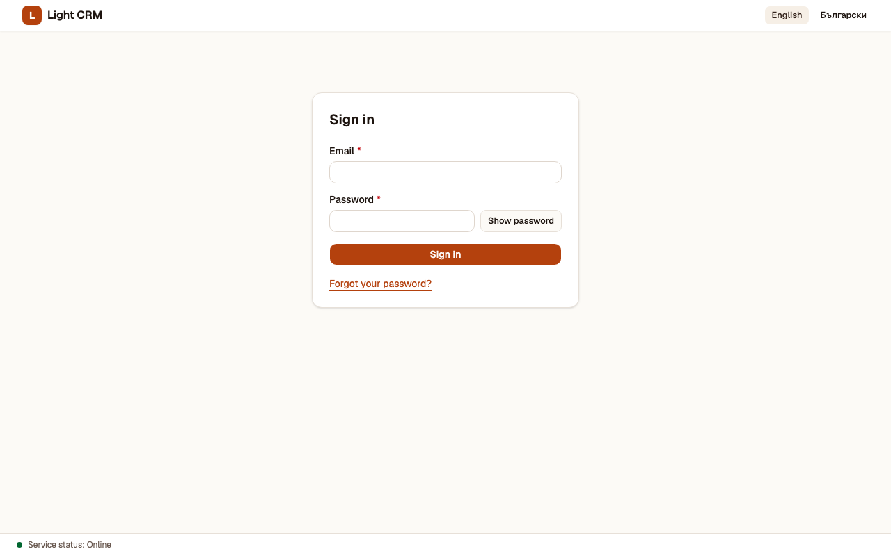
*Figure 1. Sign-in page.*

Good to know:
- After **5 wrong passwords** the account locks for **15 minutes**; the page shows when you can try again.
- A **Caps Lock is on** warning appears if it is.
- **Forgot your password?** sends you a reset link when email is set up for the CRM. If no email arrives, ask an Admin for a reset link.

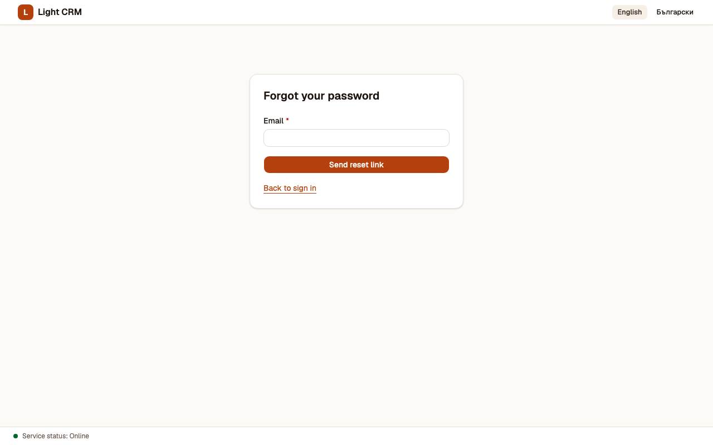
*Figure 2. Requesting a password reset link.*

### 1.3 Find your way around the screen

*Figure 3. Top bar.*

| Area | What it is for |
|---|---|
| **Hide navigation / Show navigation** | Folds the left menu away for more room. On a tablet or narrow window the button is **Menu** and opens the menu as a drawer. |
| **Light CRM** | Back to your home page. |
| **Search** | Finds organizations, contacts, leads and opportunities, in Cyrillic or Latin ([chapter 8](#8-finding-things-search-lists-and-filters)). |
| **Assistant** | Opens the AI assistant, if your Admin has switched it on ([chapter 10](#10-the-ai-assistant)). |
| **Your name** | Your menu: **My profile**, language and **Sign out**. |

The left menu lists the areas you work in. The page you are on is highlighted with a terracotta bar.

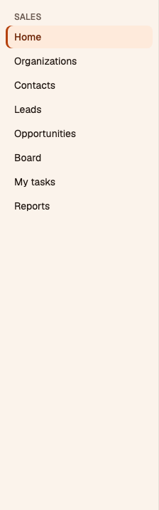
*Figure 4. Your menu.*

Every list works the same way: **click anywhere on a row** to open the record, or **Ctrl-click** (Cmd-click on a Mac) to open it in a new tab. Search, filters and sorting are kept in the page address, so you can bookmark a view or send the link to a colleague.

### 1.4 Your profile, password and sessions

Open **your name → My profile**.

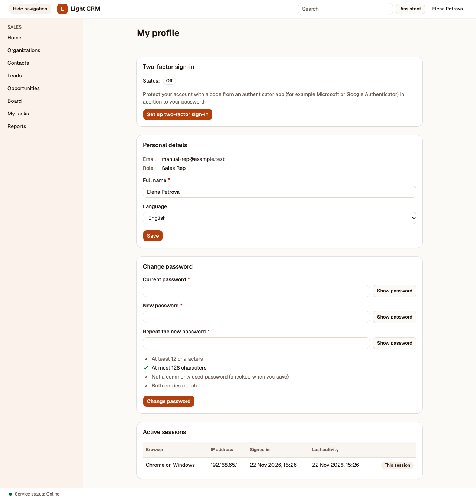
*Figure 5. My profile.*

- **Personal details:** change your **Full name** and **Language**, then **Save**.
- **Change password:** enter the current password and the new one twice, then **Change password**. Your other sessions are signed out for safety.
- **Active sessions:** every browser where you are signed in. **Sign out** ends a session you no longer use (for example a shared computer). The current session is marked **This session**.

### 1.5 Change the language

Choose **English** or **Български** under **My profile → Language** and select **Save**. The CRM remembers it and uses it on every device at your next sign-in. On the sign-in page there is a language switch as well.

### 1.6 Turn on two-factor sign-in (recommended)

1. **My profile → Two-factor sign-in → Set up two-factor sign-in**.
2. Scan the QR code with an authenticator app (Microsoft Authenticator, Google Authenticator or similar) and enter the 6-digit code.
3. Store the **ten recovery codes** somewhere safe. Each one works once if you lose your phone.

From then on you enter the current code from the app after your password.

### 1.7 Signing out and staying signed in

- **Sign out:** **your name → Sign out**. All your open CRM tabs sign out together.
- **Inactivity:** after a period without activity (8 hours unless your Admin changed it) you are signed out. Five minutes before, a dialog offers **Stay signed in**.
- If a session ends while you work, sign in again: you return to the page you were on.

---

## 2. Your home page

**User story:** *As a Sales Rep, I want to see my pipeline, forecast and tasks when I sign in, so that I know where to spend my day.*

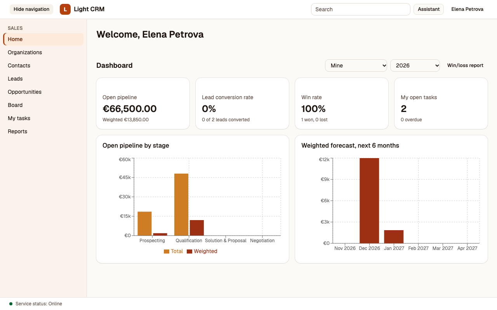
*Figure 6. Home page with your dashboard ("Mine").*

| Part | What it shows |
|---|---|
| **Mine / Everyone** and **year** | Whose figures are shown, and for which year. Choose **Mine** for your own pipeline. |
| **Open pipeline** | Value of all open opportunities, and the **weighted** value (amount × probability). |
| **Lead conversion rate** | Share of leads created in the period that were converted. |
| **Win rate** | Won versus lost opportunities in the period. |
| **My open tasks** | Your open tasks and how many are overdue. |
| **Open pipeline by stage** | Total and weighted value per stage. |
| **Weighted forecast, next 6 months** | Weighted value by expected close month. |
| **Recently viewed** | Records you opened lately in this browser (cleared when you sign out). |

**Each figure card is a shortcut:** click **Open pipeline** for the board, **Lead conversion rate** for the leads, **Win rate** for the win/loss report and **My open tasks** for your tasks.

---

## 3. Organizations and contacts

An **organization** is a company: a customer or a prospect. A **contact** is a person, usually at an organization.

### 3.1 Find an organization

**User story:** *As a Sales Rep, I want to find a customer quickly by name, EIK, VAT number or city.*

1. Select **Organizations** in the menu.
2. Type in **Search by name, EIK, VAT or city**. Narrow down with **Everyone/Mine** and the industry filter; tick **Show archived** to include archived organizations.
3. Click the row to open the organization.

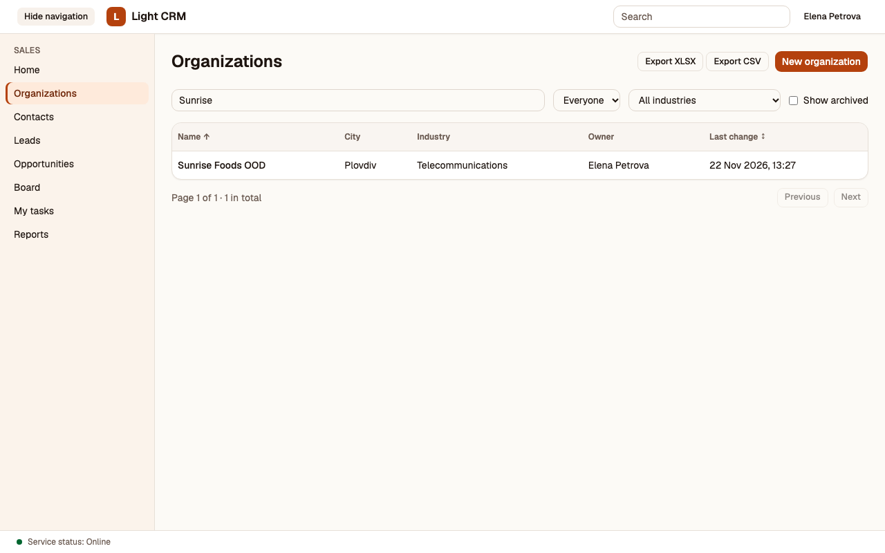
*Figure 7. Organizations list.*

### 3.2 Create an organization

**User story:** *As a Sales Rep, I want to add a new prospect without creating a duplicate of an existing company.*

1. **Organizations → New organization**.
2. Fill in at least **Name**. The form helps with the formats: **EIK / UIC** has 9 or 13 digits, **VAT number** is BG followed by 9 or 10 digits, **Website** starts with https://, **Country** is a two-letter code such as *BG*.
3. Select **Create organization**.

If an organization with the same name or EIK already exists, the CRM stops and shows **Possible duplicates** with a link to each match. Open the match to check it. Only if it really is a different company, select **Create anyway**.

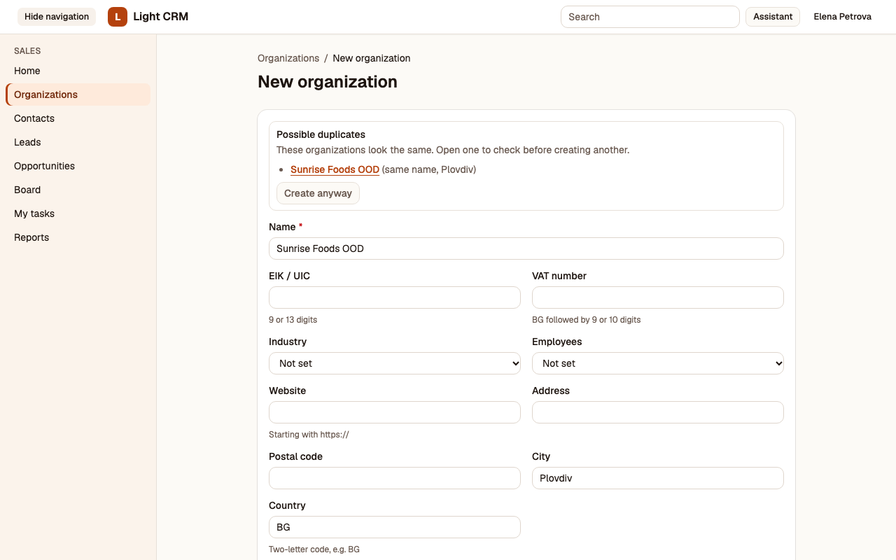
*Figure 8. The duplicate warning protects the data from double entries.*

New organizations are owned by you.

### 3.3 The organization page (360° view)

**User story:** *As a Sales Rep, I want to see everything about a customer on one page before I call them.*

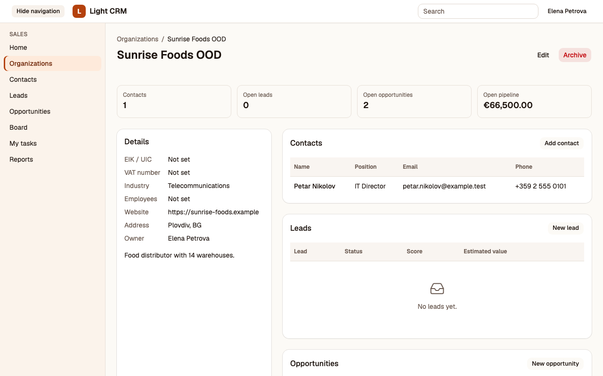
*Figure 9. Organization page.*

The page shows the counts at the top, the details, and the organization's **Contacts**, **Leads** and **Opportunities**, each with a button to add one (**Add contact**, **New lead**, **New opportunity**) already linked to this organization. Further down: **IDs in other systems** (the customer's numbers in ERP, Billing or Conclusion) and the **Timeline** of everything that happened ([chapter 7](#7-activities-tasks-and-the-timeline)).

On your own organizations you can **Edit** and **Archive**. Archiving hides the organization from lists without deleting it; a Sales Manager or Admin can restore it.

### 3.4 Contacts

Create a contact from the organization page (**Add contact**) or from **Contacts → New contact**: first and last name are required; job title, email, phone, preferred language and organization are optional. A contact linked to an organization **follows the organization's owner**.

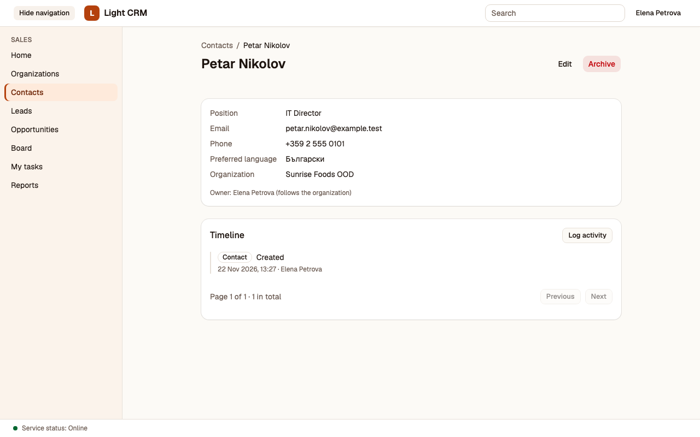
*Figure 10. Contact page. Email addresses and phone numbers are links: click to write or call.*

---

## 4. Leads: from first contact to qualified

A **lead** is an interest that is not yet a deal: a name from an event, an inbound inquiry, a referral. Leads move through these statuses:

**New → Contacted → Qualified → Converted** (into an opportunity), or **Disqualified** with a reason from any open status.

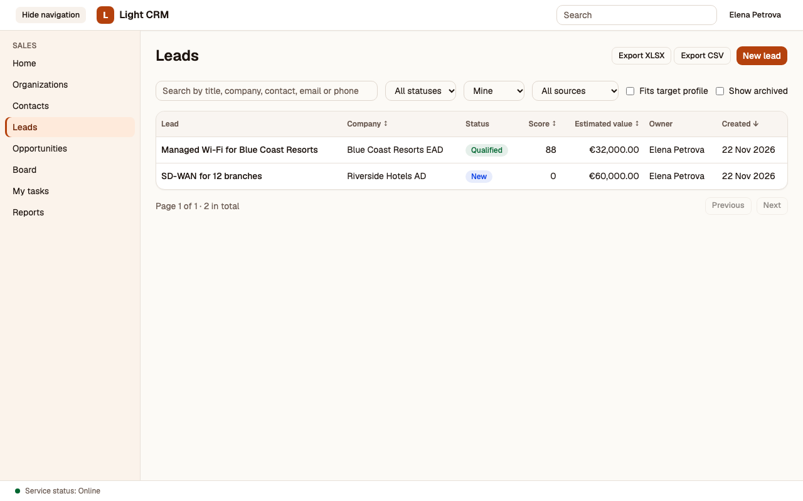
*Figure 11. Your leads. The **Score** column shows how well each lead is qualified.*

### 4.1 Capture a lead

**User story:** *As a Sales Rep, I want to record an interest in seconds, even if the company is not in the CRM yet.*

1. **Leads → New lead**.
2. Enter a **Title** (what the interest is about) and the **Company name**. That is enough to save. Add the contact person, email, phone, **Source** (campaign, inbound inquiry, referral, event…), estimated value and a description if you have them.
3. Select **Create lead**. You own the new lead.

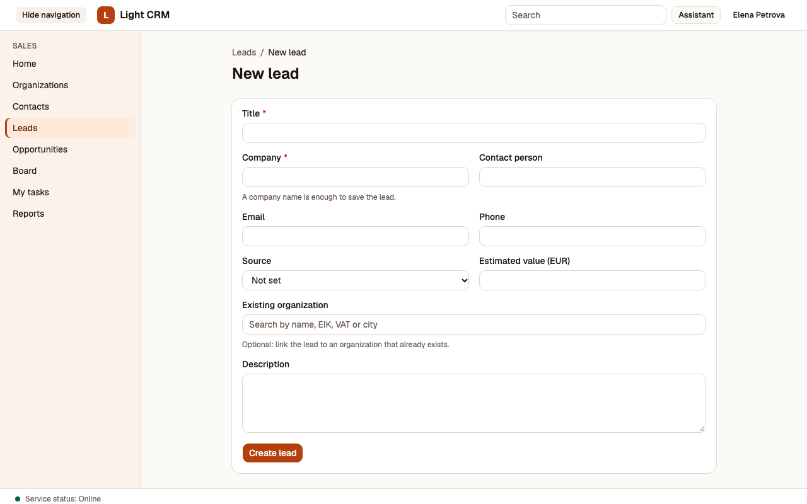
*Figure 12. New lead.*

### 4.2 Work and qualify a lead (BANT)

**User story:** *As a Sales Rep, I want to qualify a lead in a consistent way, so that only real opportunities reach the pipeline.*

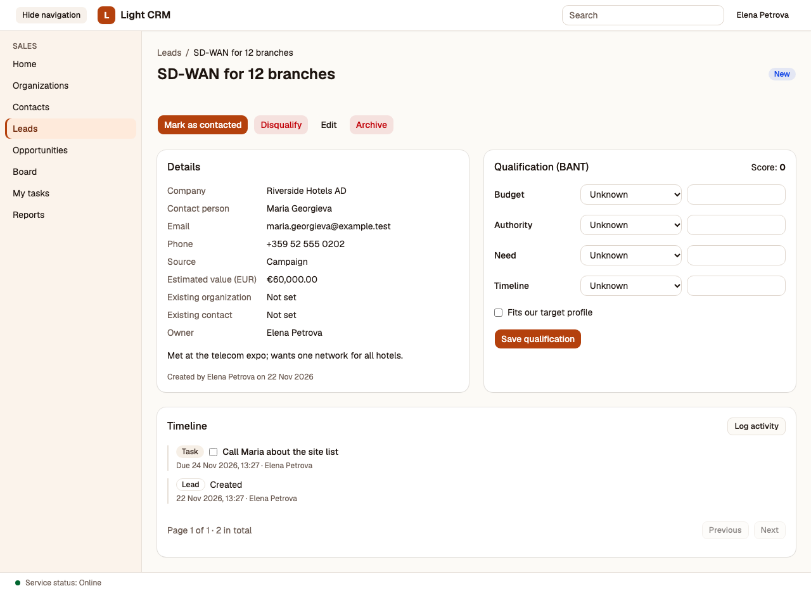
*Figure 13. A new lead with its qualification panel.*

1. After the first conversation select **Mark as contacted**.
2. In **Qualification (BANT)** set each item to **No**, **Partial** or **Yes** and add a short note:
   - **Budget** — is there money for it?
   - **Authority** — are you talking to the person who decides?
   - **Need** — is there a real problem to solve?
   - **Timeline** — when do they want it?
3. Tick **Fits our target profile** if it does, then **Save qualification**. The **Score** (0–100) updates; it is also shown in the lead list.
4. When **none of the four items is Unknown**, the **Qualify** button is available. Select it.

### 4.3 Convert a qualified lead into an opportunity

**User story:** *As a Sales Rep, I want to turn a qualified lead into an opportunity, organization and contact in one step, without typing everything again.*

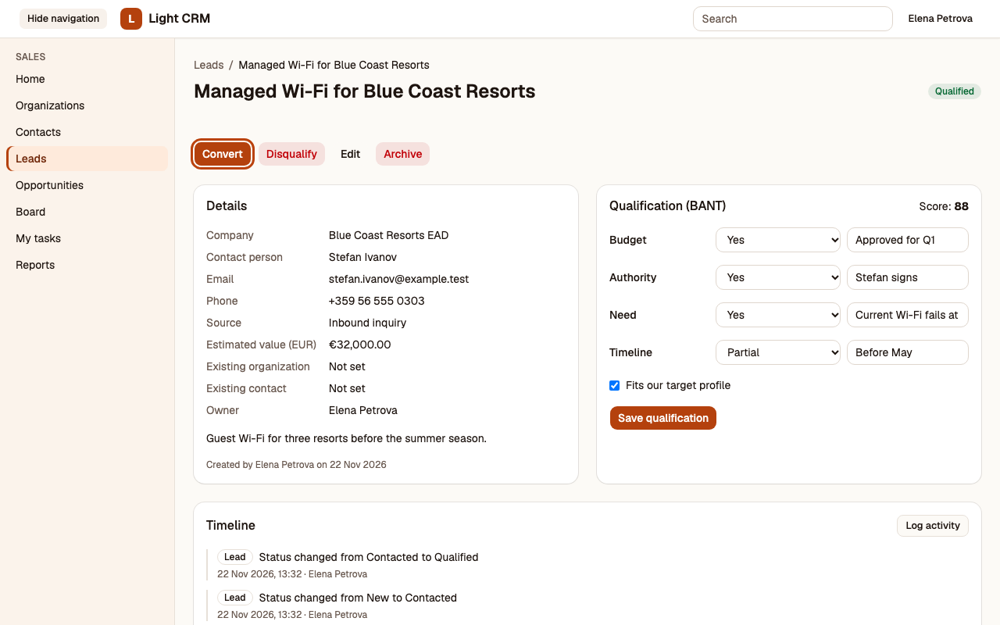
*Figure 14. A qualified lead: select **Convert**.*

1. On the qualified lead select **Convert**.
2. Check the three sections, which the CRM has filled from the lead:
   - **Organization:** create a new one, or link an existing one if the CRM found a match.
   - **Contact:** create a new one, link an existing one, or **No contact**.
   - **Opportunity:** name, amount, expected close date and starting **Stage**.
3. Select **Convert**.

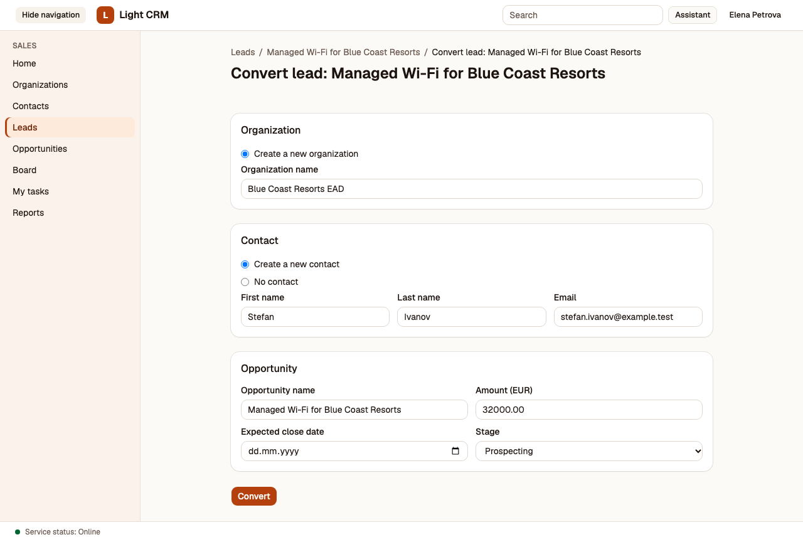
*Figure 15. Converting a lead. Everything is created together, or nothing is.*

The lead becomes **Converted** and links to the new opportunity; the opportunity links back to the lead, and the lead's activities stay visible from the opportunity.

### 4.4 Disqualify a lead

Select **Disqualify**, choose a **Reason** (for example no budget) and add a note if useful, then confirm. A disqualified or converted lead is read-only. If a disqualified lead comes back to life, ask your Sales Manager to **Reopen** it.

---

## 5. Opportunities: winning the deal

An **opportunity** is a deal you are working on: an amount in EUR, an expected close date, and a **stage** in the sales pipeline. The standard stages are:

| Stage | Default probability |
|---|---|
| Prospecting | 10% |
| Qualification | 25% |
| Solution & Proposal | 50% |
| Negotiation | 75% |
| Closed Won | 100% |
| Closed Lost | 0% |

Your Admin may have adjusted them. The **weighted amount** is amount × probability; it drives the forecast.

### 5.1 Create an opportunity

1. **Opportunities → New opportunity** (or **New opportunity** on an organization page, or by converting a lead).
2. Enter **Name** and choose the **Organization** (both required). Add the primary contact, **Amount (EUR)**, **Expected close date**, **Stage**, **Next step** and other details.
3. Select **Create opportunity**.

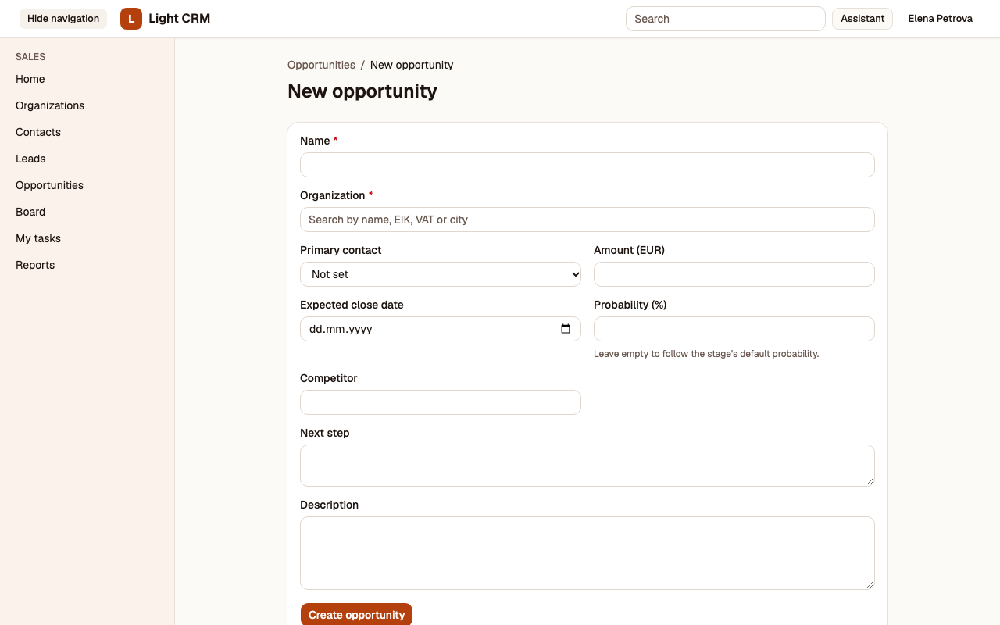
*Figure 16. New opportunity.*

### 5.2 Move through the stages with the sales path

**User story:** *As a Sales Rep, I want to see at a glance where a deal stands and move it on with one click.*

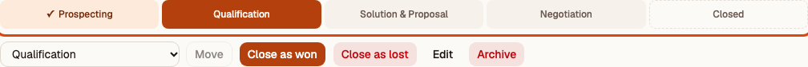
*Figure 17. The sales path on an opportunity.*

The **sales path** across the top of the opportunity shows passed stages (ticked), the current stage (filled) and the next ones. **Click a stage to move the opportunity there.** You can also choose the stage in the **Stage** list and select **Move**.

Every stage change is recorded in **Stage history** with who and when.

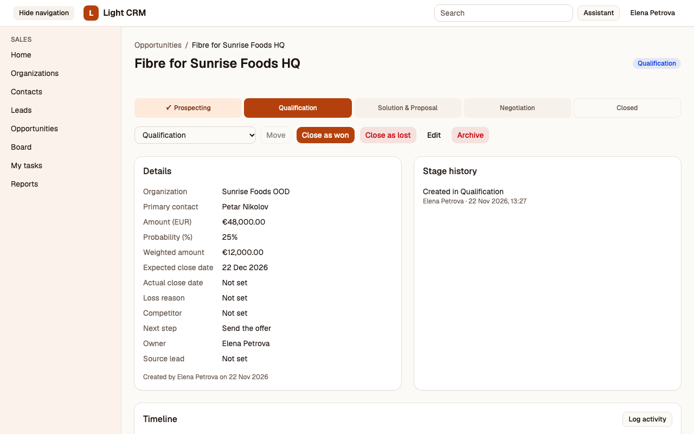
*Figure 18. Opportunity page.*

### 5.3 Close an opportunity as won or lost

**User story:** *As a Sales Rep, I want to record the outcome of a deal, and why we lost it, so that the team learns from it.*

- **Won:** select **Close as won**. The **Actual close date** is today unless you pick another date. Select **Close as won** again to confirm.

  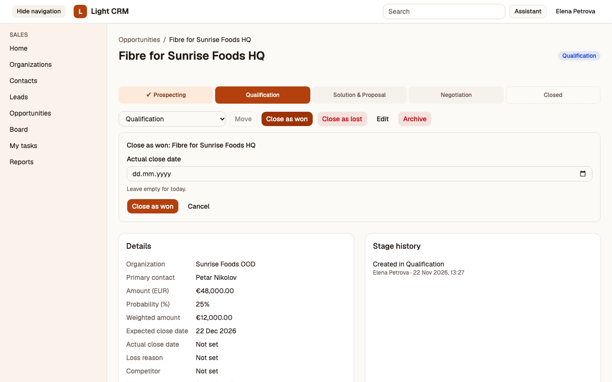
  *Figure 19. Closing as won.*

- **Lost:** select **Close as lost**, choose the **Loss reason** (required) and, if known, the competitor, then confirm.

  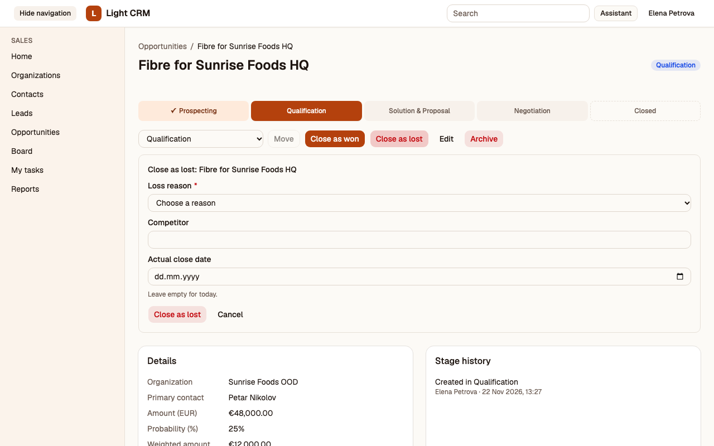
  *Figure 20. Closing as lost: the reason is required.*

A closed opportunity is read-only, and the sales path shows the outcome in green (won) or red (lost). If a deal reopens, a Sales Manager or Admin can **Reopen** it.

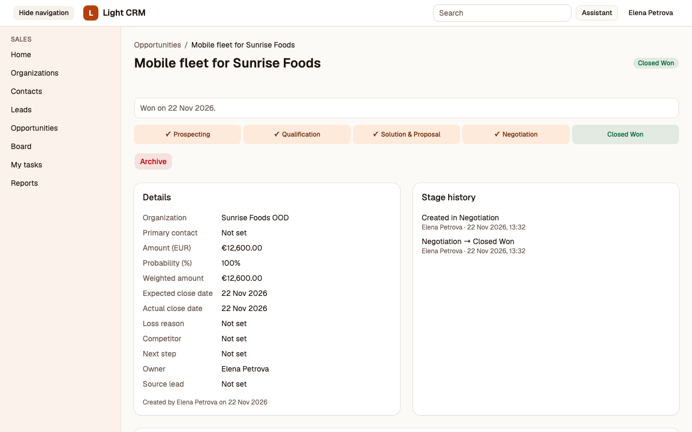
*Figure 21. A won opportunity.*

### 5.4 "Needs attention"

An opportunity gets the **Needs attention** badge when it has had **no activity for 14 days** (your Admin can change this) or its **expected close date has passed**. Log an activity or update the date to clear it.

### 5.5 Take over a colleague's opportunity

When a colleague is away, you can select **Take over** on their open opportunity or lead to make yourself the owner. The change is recorded in the audit log.

---

## 6. The pipeline board

**User story:** *As a Sales Rep, I want to see all my deals by stage and move them by dragging.*

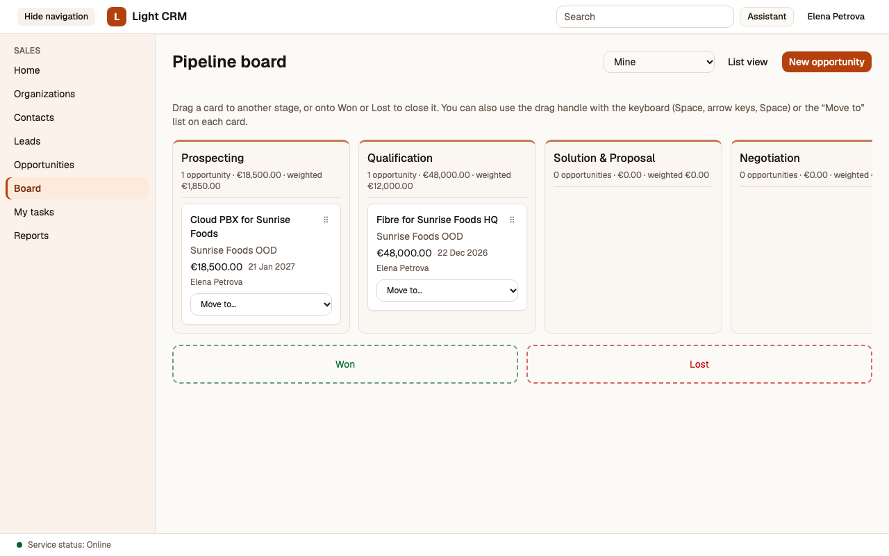
*Figure 22. Pipeline board.*

1. Select **Board** in the menu. Choose **Mine** to see only your deals.
2. **Drag a card** to another stage. Drop it on **Won** or **Lost** to close it; **Lost** asks for the reason.
3. Without a mouse: focus the card's handle (⠿), press **Space**, move with the **arrow keys**, and press **Space** to drop. Or use the card's **Move to…** list.

Each column header shows the number of opportunities, their total and their weighted value. Cards you may not change cannot be dragged.

---

## 7. Activities, tasks and the timeline

**User story:** *As a Sales Rep, I want to record every call, meeting and email and set myself follow-up tasks, so that nothing is forgotten and colleagues can see the history.*

### 7.1 Log an activity

1. On a lead, opportunity, organization or contact, select **Log activity** in the **Timeline**.
2. Choose the **Type**: **Note**, **Call**, **Meeting**, **Email** (logged by hand) or **Task**.
3. Enter a **Subject** (required) and the **Details**. **Date and time** is now unless you choose another.
4. For a **Task**, set **Due** and **Assigned to** (you, or a colleague).
5. Select **Log activity** (or **Create task**).

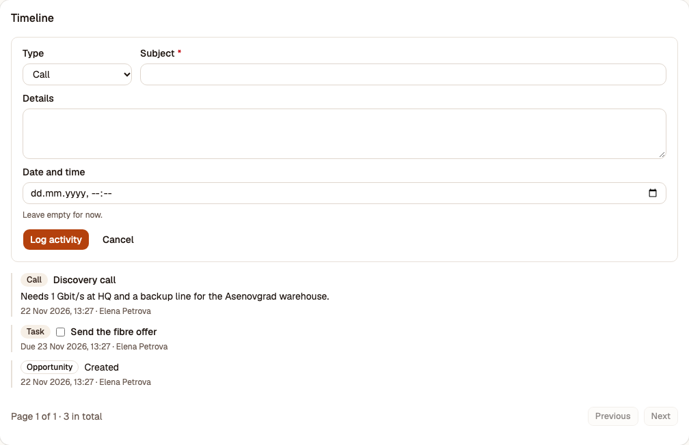
*Figure 23. Logging a call on the timeline.*

The **timeline** lists the record's activities together with system events (created, owner changed, stage changed, converted), newest first.

### 7.2 My tasks

Select **My tasks** to see the open tasks assigned to you, **overdue first**. Tick the checkbox to mark a task done; untick to reopen it.

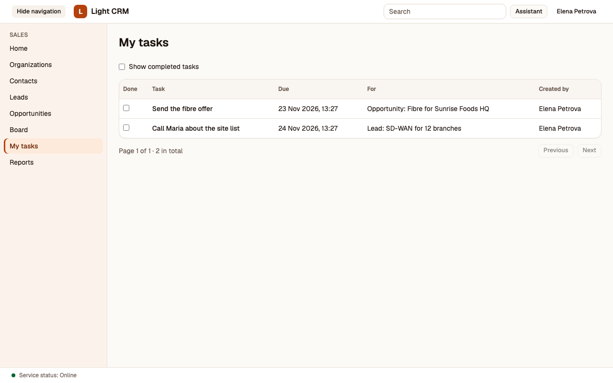
*Figure 24. My tasks.*

---

## 8. Finding things: search, lists and filters

- **Search in the top bar** looks through organizations, contacts, leads and opportunities at once. Cyrillic and Latin both work: *Петров* finds *Petrov*.

  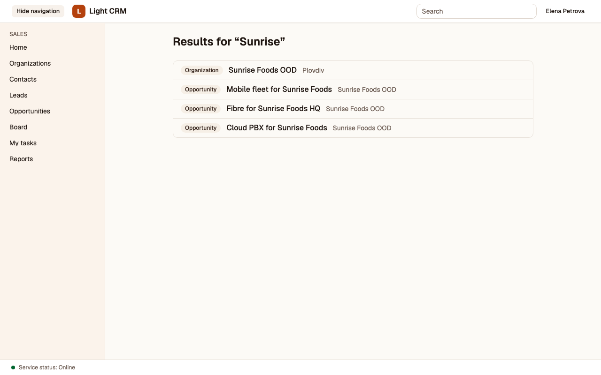
  *Figure 25. Search results.*

- **Lists** (Organizations, Contacts, Leads, Opportunities) have a search box, filters (for example **Mine**, status, stage, source) and sortable columns. Click a column title to sort; click again to reverse.
- **Show archived** includes archived records.
- The page address keeps your search and filters: bookmark it or send it to a colleague.

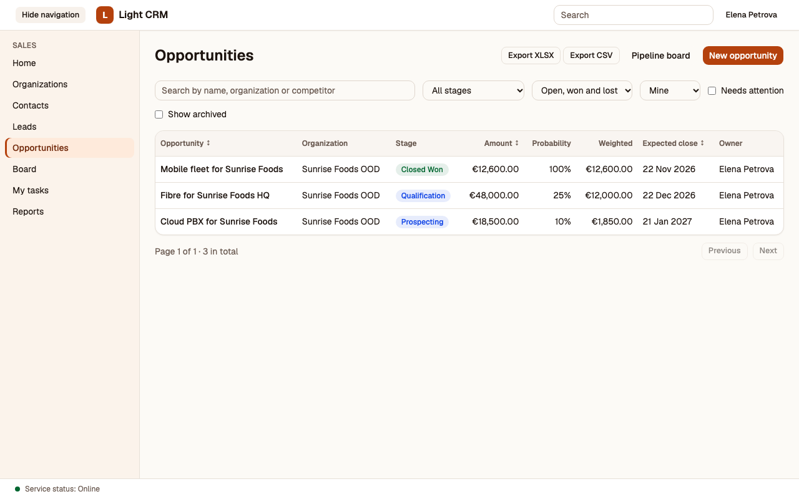
*Figure 26. A list filtered to your own records.*

---

## 9. Reports and exports

### 9.1 Win/loss report

**Reports** shows won and lost opportunities by loss reason, owner and period. Use it to see why deals are lost.

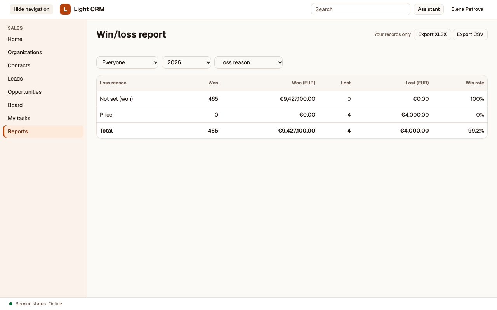
*Figure 27. Win/loss report.*

### 9.2 Export a list to Excel or CSV

**User story:** *As a Sales Rep, I want to take a filtered list into Excel.*

1. Open the list and set the search and filters you want.
2. Select **Export XLSX** (Excel) or **Export CSV** at the top. The file contains the filtered rows **that you own**: next to the buttons the screen says **Your records only**. If you need a colleague's or the whole team's records in a file, ask your Sales Manager.

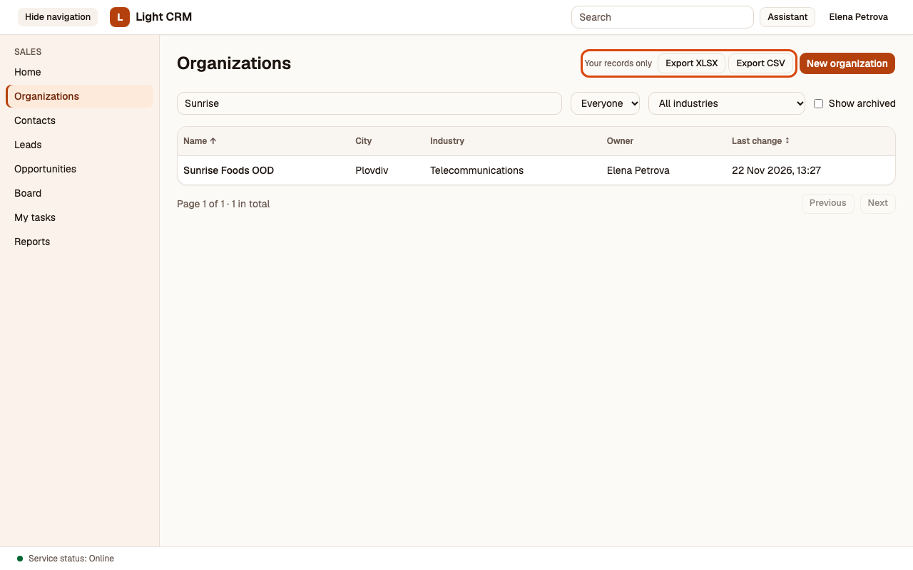
*Figure 28. Export buttons, with the "Your records only" note.*

Exports are recorded in the audit log. Handle exported files with care: they contain customer data.

---

## 10. The AI assistant

**User story:** *As a Sales Rep, I want to ask questions about my pipeline in plain language and get help writing follow-ups.*

If your Admin has switched it on, select **Assistant** in the top bar. A chat opens on the right.

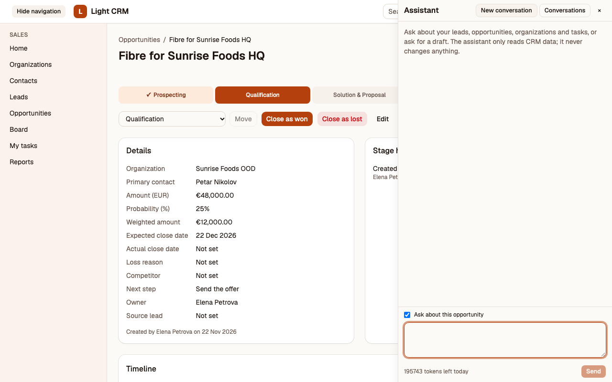
*Figure 29. The assistant, opened on an opportunity: it offers to answer about this record.*

- Ask in **English or Bulgarian**, for example: *Which of my opportunities close this month?*, *What is the pipeline value by stage?*, *Summarize the history with Sunrise Foods*, *Draft a follow-up email for this opportunity*, *What open tasks does Ivan have?*, *What are the stages of our pipeline?*, *Which loss reasons can I choose?*
- On a lead, opportunity or organization page it offers to answer **about that record**.
- Records in answers are **links**. **Copy** copies an answer; **Save as note** saves a draft as a note on the record, after you have checked it.
- Earlier chats are under **Conversations**; **New conversation** starts afresh.

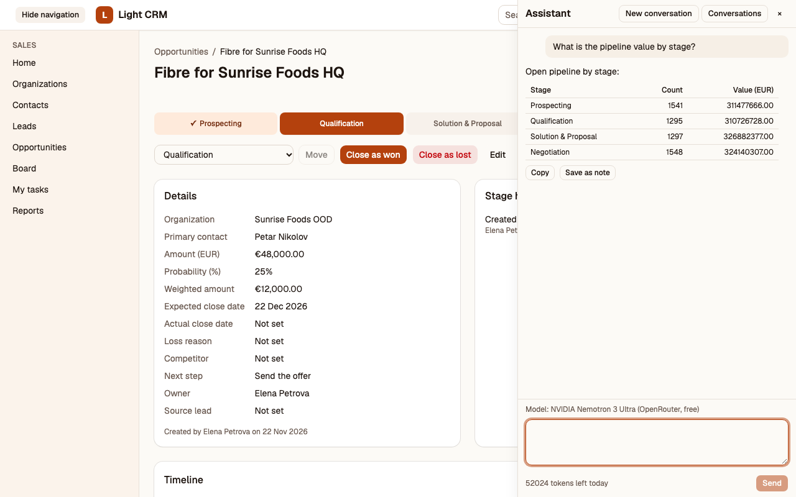
*Figure 30. An answer with figures from the CRM. (Example from a test system; your figures differ.)*

### 10.1 Let the assistant do it for you

**User story:** *As a Sales Rep, I want to say what needs doing and have the CRM prepare it, so that updating records takes seconds.*

Ask in plain words, for example:
- *Create a task due tomorrow to send the offer to Petar* (on the deal's page, or naming the record);
- *Move Fibre for Sunrise Foods HQ to Negotiation*;
- *Log a call with Petar Nikolov: he wants a quote by Friday*;
- *Close the Cloud PBX deal as lost, reason price*;
- *Create a lead: SD-WAN for Riverside Hotels, 60,000 EUR*.

The assistant prepares a **card** with exactly what will happen. **Nothing changes until you press Confirm.** **Cancel** discards it, and a card expires after 30 minutes.

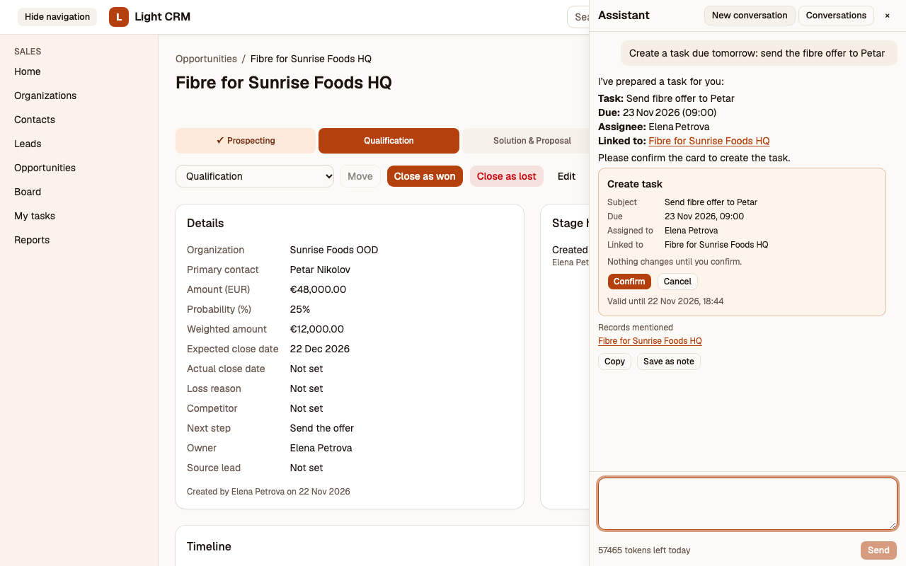
*Figure 31. A task prepared by the assistant, waiting for confirmation.*

- Cards for changes that remove or close something (archive, close as lost) are **red**: check them carefully.
- After **Confirm** the card says **Done.** and links to the record.
- If someone changed the record in the meantime, the card says **Not done.** Ask again.
- It works with your rights. It won't prepare changes to a colleague's records, and the CRM checks again when you confirm.
- Tasks, notes, calls, meetings and emails always belong to a lead, opportunity, organization or contact. If you don't say which, it asks.
- Every confirmed change appears in the audit log as made by you, "via assistant".

Keep in mind:
- The assistant changes nothing by itself: **you confirm every change**. It sees only what you may see.
- It can be wrong. **Check figures** before you use them; it says so when the CRM does not hold the answer.
- There is a **daily limit** per person, shown under the question box. The name of the **AI model** in use is shown there too; your Admin chooses it for everyone.
- An answer can take **10–30 seconds** with the default free model. The steps it takes ("Searching opportunities…") are shown while you wait, and **Stop** ends an answer early.

---

## 11. What you cannot do, and who can

| You want to… | Who can | What to do |
|---|---|---|
| Change or close a colleague's record | The owner, a Sales Manager or an Admin | Ask them, or **Take over** if it is open and agreed |
| Assign a record to someone else | Sales Manager, Admin | Ask your manager |
| Reopen a closed opportunity or a disqualified lead | Sales Manager, Admin | Ask your manager |
| Restore an archived record | Sales Manager, Admin | Ask your manager |
| Import records from Excel | Sales Manager, Admin | Send the file to your manager |
| Export colleagues' or the team's records | Sales Manager, Admin | Ask your manager |
| Create users, change roles, reset passwords | Admin | Ask an Admin |
| Change pipeline stages, lists (sources, reasons, industries) or settings | Admin | Ask an Admin |

The screens hide what you cannot do, and the server checks every action again.

---

## 12. Troubleshooting

| Problem | What to do |
|---|---|
| "Wrong email or password" | Check Caps Lock and the email. After 5 attempts the account is locked for 15 minutes. |
| I forgot my password | **Forgot your password?** on the sign-in page, or ask an Admin for a reset link. |
| My set-password link does not work | It is used or expired. Ask an Admin for a new one. |
| A record has no **Edit** button | It belongs to a colleague, or it is closed, converted or archived (see [chapter 11](#11-what-you-cannot-do-and-who-can)). |
| **Qualify** is not available | One of the BANT items is still **Unknown**. Set all four and **Save qualification**. |
| "Someone else changed this record" | A colleague saved first. The page now shows their version; make your change again. |
| I was signed out | Sessions end after inactivity. Sign in again; you return to the page you were on. |
| The **Assistant** button is missing | The assistant is switched off. Ask an Admin. |
| The assistant says it is **not available right now** | The AI provider is busy or its daily quota is used up. Try again later, or ask an Admin to choose another model. |
| Something else fails | Note what you were doing and the time, and tell an Admin; they can find it in the logs. |

---

## 13. Glossary

| Term | Meaning |
|---|---|
| **Organization** | A company: customer or prospect. |
| **Contact** | A person, usually at an organization. |
| **Lead** | An interest not yet qualified as a deal. |
| **BANT** | Budget, Authority, Need, Timeline: the four qualification questions. |
| **Opportunity** | A deal with an amount, close date and stage. |
| **Stage** | A step in the sales pipeline (Prospecting … Negotiation, Closed Won, Closed Lost). |
| **Weighted amount** | Amount × probability; used for the forecast. |
| **Owner** | The person responsible for a record; only they (and managers) can change it. |
| **Archive** | Hide a record from lists without deleting it. |
| **Timeline** | The history of a record: activities and system events. |
| **EIK / UIC** | Bulgarian company registration number (9 or 13 digits). |

---

## 14. Quick reference

| I want to… | Go to |
|---|---|
| See my pipeline and tasks | **Home**, set **Mine** |
| Add a company | **Organizations → New organization** |
| Add an interest | **Leads → New lead** |
| Qualify a lead | Lead page → **Qualification (BANT)** → **Save qualification** → **Qualify** |
| Turn a lead into a deal | Qualified lead → **Convert** |
| Move a deal to the next stage | Click the stage in the **sales path**, or drag the card on the **Board** |
| Close a deal | **Close as won** / **Close as lost** (reason required) |
| Record a call or meeting | Record page → **Timeline → Log activity** |
| Set a reminder | **Log activity → Type: Task**, set **Due** |
| See my to-dos | **My tasks** |
| Get a list into Excel | Filter the list → **Export XLSX** |
| Ask a question | **Assistant** |
| Change language or password | **Your name → My profile** |
