# Light CRM — Manual for Viewers

**For:** colleagues with the **Viewer** role. You follow the sales pipeline (for example in management, finance, delivery or product teams) but don't work deals yourself.\
**Covers:** Light CRM Release 1 (November 2026). The screens are in English; you can switch to Bulgarian at any time (see [1.4](#14-change-the-language)).\
**Time to read:** about 10 minutes.

> **What a Viewer can do.** You can **see everything** in the CRM: organizations, contacts, leads, opportunities, the pipeline board, dashboards and reports. You can search, export lists and ask the AI assistant. You **cannot create, change or delete** anything: the screens don't show those buttons, and the server refuses such changes.

---

## Contents

1. [Getting started](#1-getting-started)
2. [The dashboard](#2-the-dashboard)
3. [Looking up customers, leads and deals](#3-looking-up-customers-leads-and-deals)
4. [The pipeline board](#4-the-pipeline-board)
5. [Reports and exports](#5-reports-and-exports)
6. [The AI assistant](#6-the-ai-assistant)
7. [When you need a change](#7-when-you-need-a-change)
8. [Troubleshooting](#8-troubleshooting)
9. [Glossary](#9-glossary)
10. [Quick reference](#10-quick-reference)

**How to read the steps.** Names of buttons, menus and fields are in **bold**, exactly as they appear on screen. *Italic* marks something you type. The people and companies in the screenshots are fictional.

---

## 1. Getting started

### 1.1 Set your password (first time only)

An Admin creates your account and gives you a **one-time link**. The link expires, so use it soon.

1. Open the link. The **Set your password** page opens.
2. Type a new password twice. The checklist under the fields turns green as each rule is met: **at least 12 characters**, at most 128, not a commonly used password, and both entries match.
3. Select **Save password**, then sign in.

### 1.2 Sign in

Open the Light CRM address your company gave you. Enter your work **Email** and **Password**, then select **Sign in**.

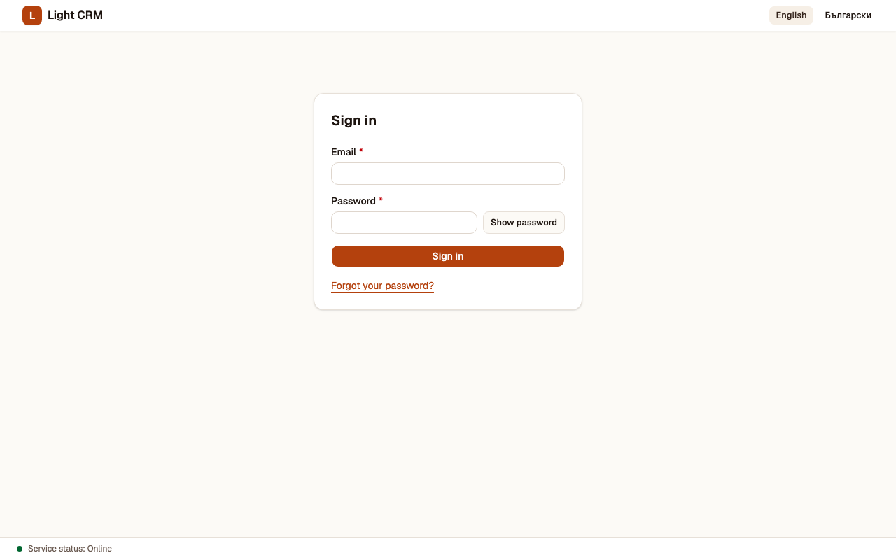
*Figure 1. The sign-in page.*

- After **5 wrong passwords** the account is locked for **15 minutes**.
- **Forgot your password?** sends you a reset link if email is set up for the CRM. If no email arrives, ask an Admin.

### 1.3 Find your way around the screen

*Figure 2. The top bar.*

The **top bar** has **Search**, the **Assistant** button and **your name**. Your name opens a menu with **My profile** and **Sign out**. The **left menu** lists the areas you can open:

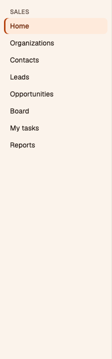
*Figure 3. Your menu.*

In every list, **click anywhere on a row** to open the record. **Ctrl-click** (Cmd-click on a Mac) opens it in a new tab. The page address keeps your search and filters, so you can bookmark a view or send the link to a colleague.

### 1.4 Change the language

Open **your name → My profile**, choose **English** or **Български** under **Language**, and select **Save**. The setting applies on every device from your next sign-in.

### 1.5 Profile, password and sign-out

- **My profile** is also where you **change your password** and see your **active sessions**. You can sign out a session you no longer use there.
- **Two-factor sign-in** (recommended): **My profile → Set up two-factor sign-in**. Scan the QR code with an authenticator app and keep the recovery codes safe.
- After a period of inactivity (8 hours by default) you are signed out. Five minutes before, a dialog offers **Stay signed in**.

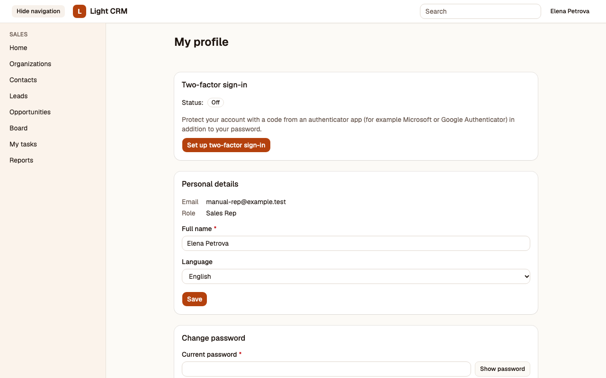
*Figure 4. My profile.*

---

## 2. The dashboard

**User story:** *As a Viewer, I want to see the pipeline, the forecast and the win rate at a glance.*

Your **Home** page is the team dashboard.

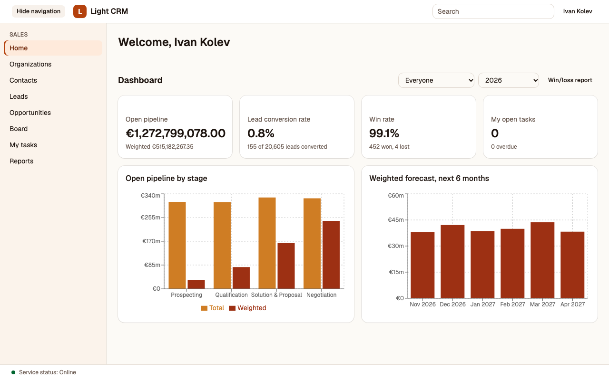
*Figure 5. The dashboard.*

| Part | What it shows |
|---|---|
| **Everyone** and **year** | The scope and the calendar year of the figures. |
| **Open pipeline** | The value of all open opportunities, and the **weighted** value (amount × probability). |
| **Lead conversion rate** | The share of leads created in the period that became opportunities. |
| **Win rate** | Won compared with lost opportunities in the period. |
| **Open pipeline by stage** | Total and weighted value per sales stage. |
| **Weighted forecast, next 6 months** | The expected value by month of expected close. |

**Each figure card is a link:** select **Open pipeline** for the board, **Lead conversion rate** for the leads, and **Win rate** for the win/loss report.

---

## 3. Looking up customers, leads and deals

**User story:** *As a Viewer, I want to look up a customer and see its contacts, open deals and recent history before a meeting.*

### 3.1 Search

Type a name, an EIK or an email address in **Search** in the top bar. The search covers organizations, contacts, leads and opportunities, in Cyrillic or Latin: *Петров* also finds *Petrov*.

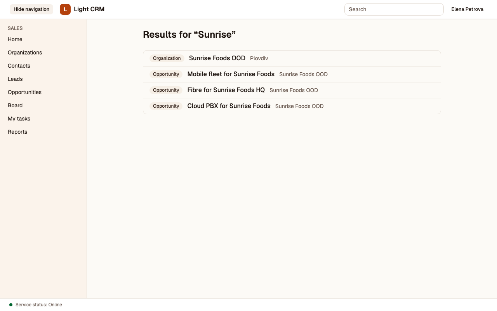
*Figure 6. Search results.*

### 3.2 Lists

**Organizations**, **Contacts**, **Leads** and **Opportunities** each open a list with a search box, filters and sortable columns. Select a column title to sort by it; select it again to reverse the order.

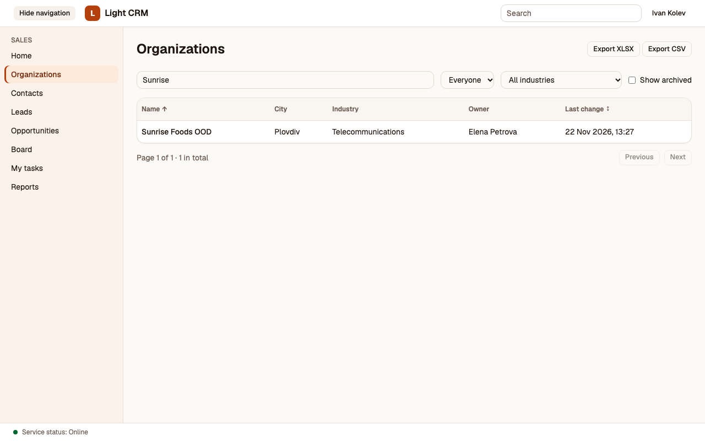
*Figure 7. A list. There is no "New" button for Viewers.*

### 3.3 Record pages

A record page shows the details, the related records and the **timeline**. The timeline lists every note, call, meeting, email and task, together with system events such as "stage changed", newest first.

On an **opportunity**, the **sales path** across the top shows the stages already passed (ticked), the current stage (filled) and the stages still ahead. For you it is a progress indicator only; it doesn't change anything.

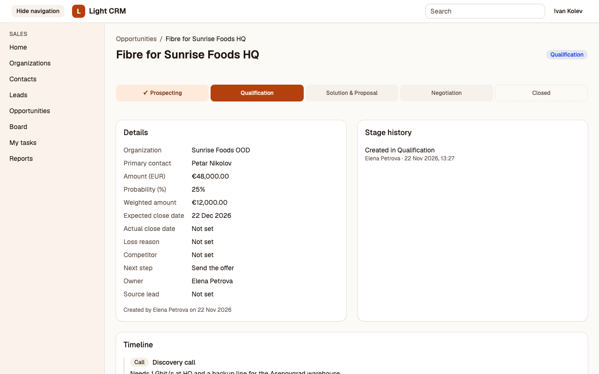
*Figure 8. An opportunity, read-only.*

On a **lead**, the **Qualification (BANT)** panel shows how the lead was assessed: **B**udget, **A**uthority, **N**eed and **T**imeline, plus a score from 0 to 100.

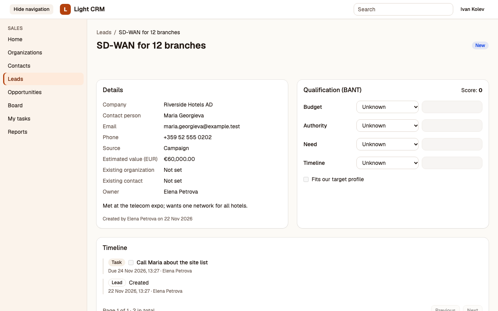
*Figure 9. A lead with its qualification.*

---

## 4. The pipeline board

**User story:** *As a Viewer, I want to see all open deals by stage.*

Select **Board**. Each column is an open stage, with the number of opportunities, their total value and their weighted value. Each card shows the deal, the organization, the amount, the expected close date and the owner. A **Needs attention** badge means the deal has had no activity for a while, or its close date has passed.

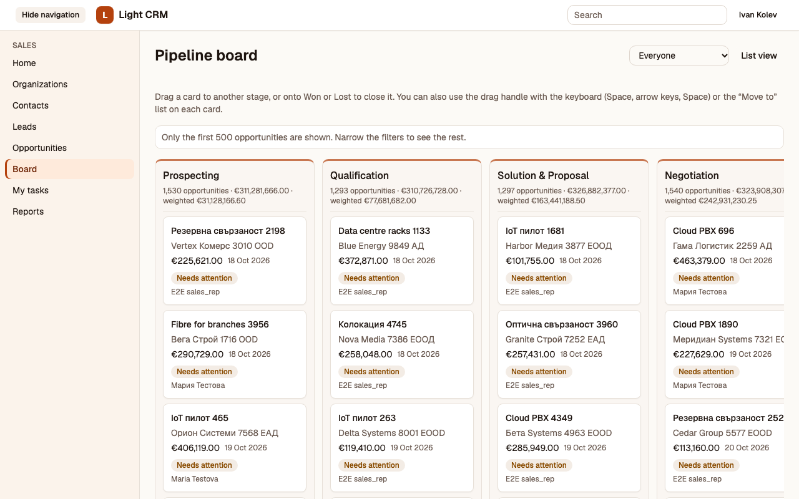
*Figure 10. The pipeline board.*

The help text above the board explains dragging. That applies to the sales team: **as a Viewer you can't move cards**. When the board holds very many deals, it shows the first 500. Use the list view (**List view**) and its filters to see the rest.

---

## 5. Reports and exports

- **Reports** opens the **win/loss report**: won and lost deals by loss reason, owner and period.

  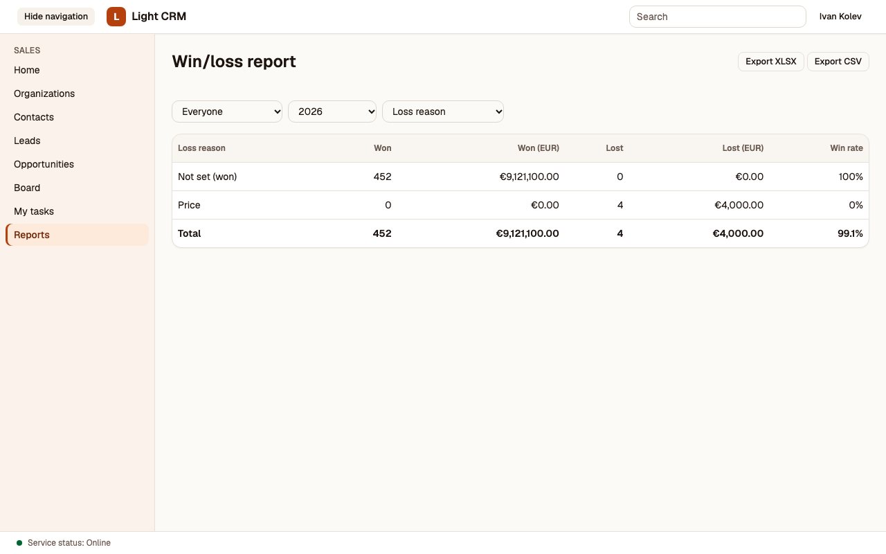
  *Figure 11. The win/loss report.*

- **Export:** on a list, set the search and filters you want, then select **Export XLSX** (Excel) or **Export CSV**. The file contains exactly the rows you filtered. Every export is recorded in the audit log. Exported files contain customer data, so store and share them according to company policy.

---

## 6. The AI assistant

If your Admin has switched it on, select **Assistant** in the top bar. Ask in English or Bulgarian, for example: *What is the pipeline value by stage?* or *Which opportunities close this month?*

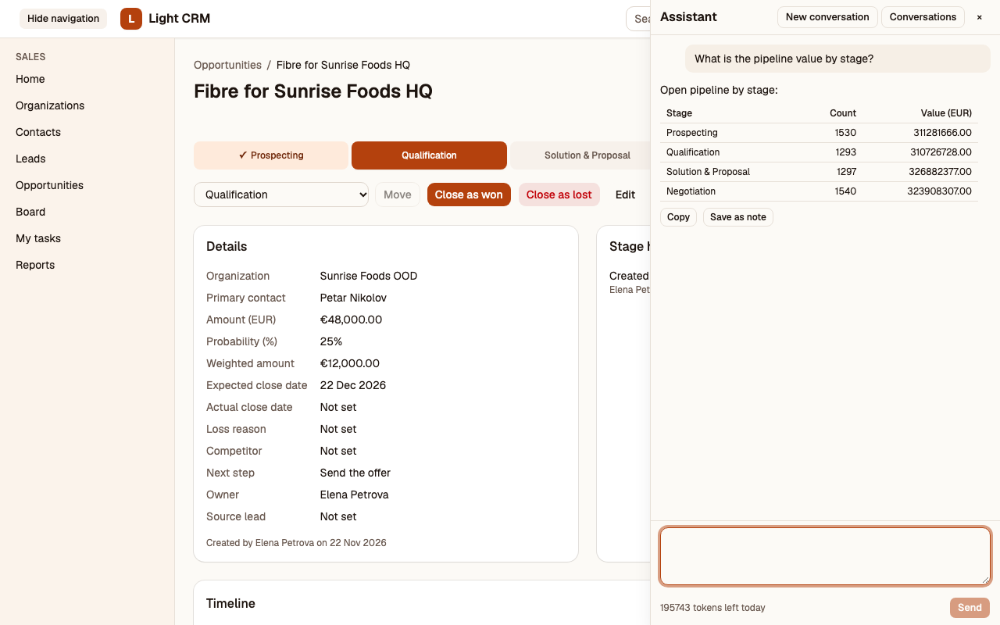
*Figure 12. An answer from the assistant. (Example from a test system; your figures will differ.)*

- The assistant **only reads** CRM data, and only what you are allowed to see.
- Records mentioned in an answer are links. **Copy** copies the answer.
- Check the figures before you rely on them. The assistant says so when the CRM doesn't hold the answer.
- There is a **daily limit** per person, shown under the question box.

---

## 7. When you need a change

You can't change data yourself. Here is who to ask:

| You notice… | Ask |
|---|---|
| A wrong detail on a customer, lead or deal | The record's **owner** (shown on the record), or a Sales Manager |
| A missing customer or contact | A Sales Rep or Sales Manager |
| You need to edit records yourself | An Admin, to change your role (with your manager's approval) |
| A problem with your account or password | An Admin |

---

## 8. Troubleshooting

| Problem | What to do |
|---|---|
| "Wrong email or password." | Check Caps Lock and the email address. After 5 attempts the account is locked for 15 minutes. |
| I forgot my password | Use **Forgot your password?**, or ask an Admin for a reset link. |
| I don't see Edit or New buttons | This is expected: Viewers have read-only access. |
| The **Assistant** button is missing | The assistant is switched off. Ask an Admin. |
| I was signed out | Sessions end after a period of inactivity. Sign in again and you return to the page you were on. |

---

## 9. Glossary

| Term | Meaning |
|---|---|
| **Organization** | A company: a customer or a prospect. |
| **Contact** | A person, usually at an organization. |
| **Lead** | An interest that hasn't yet been qualified as a deal. |
| **Opportunity** | A deal, with an amount, an expected close date and a stage. |
| **Stage** | A step in the sales pipeline: Prospecting, Qualification, Solution & Proposal, Negotiation, Closed Won, Closed Lost. |
| **Weighted amount** | The amount × the probability of winning. The forecast adds these up. |
| **Owner** | The person responsible for a record. |
| **Needs attention** | A deal with no recent activity, or whose expected close date has passed. |

---

## 10. Quick reference

| I want to… | Go to |
|---|---|
| See the pipeline and forecast | **Home** |
| Find a customer | **Search** in the top bar |
| See open deals by stage | **Board** |
| See why deals were lost | **Reports** |
| Get a list into Excel | Filter the list → **Export XLSX** |
| Ask a question | **Assistant** |
| Change language or password | **Your name → My profile** |
